## 夜晚和清晨

瑞安航空大晚上飞抵杜布罗夫尼克。有直达杜布罗夫尼克汽车总站 *Autobusni kolodvor* 的机场大巴，但 14 公里每个人收 $10$€ 有点坑。我们订了位于 *Ul. Đura Basaričeka 2* 的爱彼迎民宿，距离汽车总站步行约 $12 \min$，而且地势高得带着行李爬楼梯，听起来打车会好一些。根据小红书上的攻略，杜城主要靠 Uber 和 Bolt 打车，我各自注册了新账号：前者送了我前五次 $-7$€ 的优惠，券前的特惠/标准打车价约为 $30$€/$47$€；后者的打车价约为 $40$€。先贪了一波 $23$€ 的 Uber 特惠，打了五分钟都没反应，切换成 $40$€ 后很快就打到了，这就是资本主义。

我们的房子在高层，夜晚俯视整个杜城别有一番韵味。整个克罗地亚行程里（杜城和斯普利特）我们都订了民宿，都没有配备常规的被子，而是两份薄薄的凉被（仅仅只有一层布），侧面印证了地中海气候的温暖。

早上 $9:00$ 我们花 $24$€ Uber 打车前往 *Bosanka Viewpoint*，这是位于杜城山坡上的著名观景台。整个山坡很长，除了一条仅能容纳一辆车行驶的铺装路外，两侧都是嶙峋的碎石和稀疏的草木。这里游客的密度不高，但只要是开阔的地方，就总能找到一两个身影在俯瞰和拍照。说来也奇怪，整个杜城里国人的比例不算太高，但这个山坡上占比能达到一半。时不时会有一辆车路过停下，几位游客下车拍照打卡，让我想起了冰岛的一日团模式。

我们一路朝着山顶步行，前往 *Restaurant Panorama* 吃早午饭。沿路可以看到杜城网红的 50 米空中自行车项目，$40$€ 可体验以杜城为底片的悬空出片，恐高玩家远远绕行。励颖本来只预约到了 $10:00$ 的靠窗第二排，热心的服务员帮我们换到了第一排最后一个位置，唯一的问题是阳光很晒。我俩点了一盘 $29.5$€ 的虾仁西葫芦烩饭 *Risotto with shrimps & courgettes*，一碗 $9.8$€ 的杜城传统焦糖奶冻 *Dubrovnik cream caramel* 和一杯 $5.9$€ 的卡布奇诺 *Cappuccino*。烩饭味道有点咸，焦糖奶冻口味非常好。可能是因为奶冻实在太甜太正宗了，有一只蜜蜂全程盘旋在我们的桌子上方，我大呼小叫挥舞了很久都没赶走，最后只能抢在蜜蜂前，三两口把奶冻吃光。隔壁桌的外国老哥非常有趣，不仅乐呵地看着我拍打蜜蜂，还指指他桌上的头盔问我 ***Do you want to borrow my helmet?***

下山缆车的窗户上贴有票价和一个 推荐安装 GoCableCar App 的二维码，但 Google Play 表示这个软件太老无法在我的手机上安装。找了一圈没找到人工售票窗口，我寻思可能只能在 App 里购票，费了老大的劲去 APKPure 下载 APK，点开后发现 APP 好像只有缆车信息实时查询的简易功能。我们去求助纪念品店结账柜台的工作人员，她表示就是在她那里买。缆车的标准价格是单程 $18$€ 往返 $30$€，柜台要加收每人 $0.6$€ 的手续费——**这是我认为杜城最坑的项目**（比下文的巧克力冻香蕉还离谱！），全程不过两三分钟，收费巨高，也没领略到特别的景色。

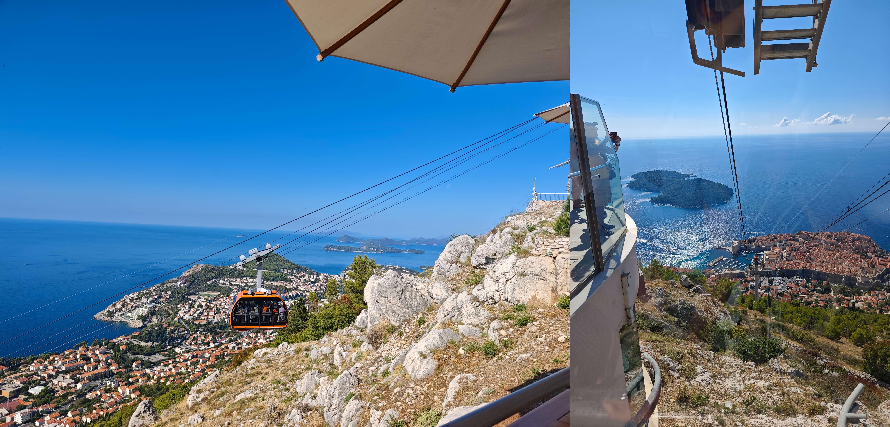

## 老城

从山上顺着阶梯而下，就到了杜布罗夫尼克老城东侧的普洛切门 *Ploce Gate*。虽然没有去过重庆，这种依山而建的建筑风格总让我想到这个山城。站在普洛切门前的桥上，可以仰望湛蓝的天空，俯瞰停满了小船的港口。

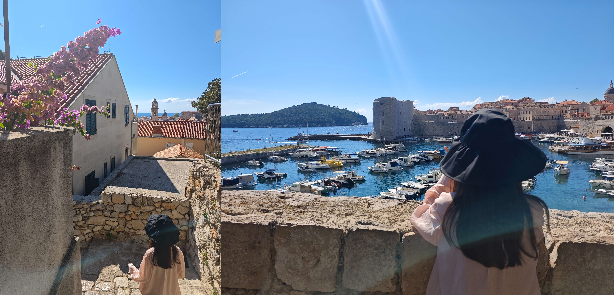

穿过城门进入老城，脚下的路和周围的建筑都是用石头搭成，透出一股庄严肃穆。这里有一家很有名的冰激凌店 *peppino's gelato*，励颖小跑着进入，二话不说买了份 $7.5$€ 的双球 cup。在后续大量品鉴 *gelato* 后，我才醒悟这个价格很高（双球的均价在 $5$€ 左右），主要也拜这家店得天独厚的位置所赐，周围都是城墙没什么竞品。

城墙上能看到 *Dubrovnik Pass* 的宣传牌。这是一种杜城推出的一日/二日/三日通票，覆盖公共交通和主要景点。一日通票的单价是 $40$€，而其中包含的最重要的景点 杜布罗夫尼克城墙 *Dubrovačke zidine* 的零售价也是 $40$€，所以大家都会买前者（这何尝不是一种价格歧视）。于是我购入两份 Daily Pass，正式开始老城的探索之旅。

圣布莱斯教堂 *Crkva sv. Vlaha* 在下午 $16:00$ 才开门，我们只能先逛南面的总督宫 *Kulturno-povijesni muzej u Kneževu dvoru*。杜布罗夫尼克旧称拉古萨 *Ragusa*，从 14 世纪到 1808 年共和国灭亡，这里一直是共和国总督的官邸和办公地。总督任期只有一个月，且任期内必须住在宫里、不得随意离开——这是为了防止权力集中而设计的制度。这里总体呈现哥特-文艺复兴的过渡风格，比如内院中庭的文艺复兴式拱廊（曾经宫内火药库爆炸损毁后重建的）：底层哥特尖拱、上层文艺复兴圆拱，配上精美的柱头雕刻。如今总督宫算是杜城的文化历史博物馆了，不同的房间里展出了共和国时期的家具、油画、雕塑、钱币、钥匙（城门的原配钥匙）等。总督宫还是拉古萨共和国的司法中心，带铁门和铁窗的拱顶石室是总督宫的监狱囚室（地牢），也是权游里关押龙的地方。

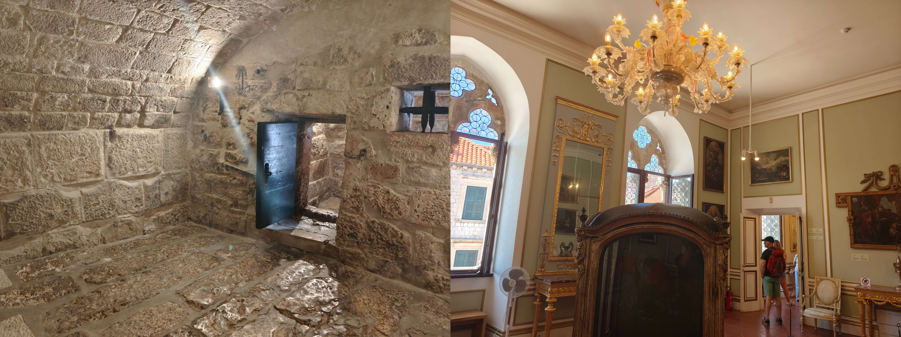

接下来逛的是杜布罗夫尼克主教座堂 *Prvostolnica Uznesenja Blažene Djevice Marije*。据说这座教堂最早能追溯到 1192 年，当时英格兰国王理查一世十字军东征归来时，在洛克鲁姆岛附近遇海难幸存，许愿建此教堂。1667 年大地震使得原来的罗马式大教堂整体坍塌，后在 1673–1713 年重建为罗马巴洛克风格。红白相间的大理石棋盘格地面是大教堂鲜明的特色。教堂的中殿采用标准的巴洛克风格，白墙配科林斯柱式壁柱，顶部是连续的筒形拱顶。和卡尔教堂类似，背后有个巨大的巴洛克管风琴楼，目前管风琴在重大节日仍投入使用。

沿着斯特拉顿 *Stradun* 主街向西逛，一直走到最西边的皮勒门 *Pile Gate*。杜城有很多名为 *mlinar* 的连锁面包店，光是老城里就有好几家。我们在购买可颂时遇到个尴尬的问题：有两种口味的可颂相邻挨着摆放，标价分别是 $1.1$€ 和 $2.2$€。我们在购买时点了前者，为了方便店员找零我递过去一枚 $10$ 分的硬币和一张 $5$€ 的纸币。结果店员看完后评价了一句 *Alright* 然后递给我了一枚 $2$€ 的硬币和一枚 $1$€ 的硬币。这下我头涔涔了，联想起他这句评语，估计是他错看成了后者并以为我们想省 $10$ 分——此时最能化解双方尴尬的是我们带着这个可颂默默溜走。

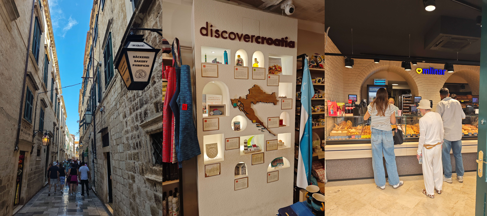

根据励颖的攻略，从皮勒门上城墙会比较拥挤，最佳方案是上来时的普洛切门。于是我带着她折返东门，这次选择横穿一些小巷，巷边可能也会开有小吃店或纪念品店。**杜城和《权力的游戏》这部剧绑定得太深**，纪念品店里多少带一点权游的元素，甚至还有几家满是权游道具、只出售权游周边的“痛店”。**杜城还是一座猫猫痛城**，石砌小巷、阶梯，甚至后面游览的城墙缝隙里，都是猫猫藏身和晒太阳之所。南欧地中海沿岸普遍有社区猫传统（猫不归某一家所有，而是整个街区共同投喂），温暖的地中海气候让猫全年都能户外生存；而杜城自古是海港，码头老鼠多，渔民和店家给猫留鱼、猫猫当"专业捕鼠雇员"的合作关系更是稳固。因此在很多纪念品店里都有“猫条”售卖。

老城店里的水价甚是昂贵，一瓶普通的 500ml 矿泉水，我们没看到过 $3$€ 以下的价格。折返到东门附近时我们发现了贡杜利奇广场集市 *Gundulićeva poljana*，这是一个露天集市，售卖水果、手工艺品、薰衣草制品等。广场中央立着伊万·贡杜利奇 *Ivan Gundulić* 的铜像，他是 17 世纪杜城最著名的巴洛克诗人，代表作是史诗《奥斯曼》。克罗地亚的达尔马提亚地区（扎达尔 → 希贝尼克 → 斯普利特→ 杜布罗夫尼克海岸带）盛产薰衣草，因为这里阳光充沛、石灰岩土壤干爽，恰好是薰衣草最爱的生长环境。我购入一套 $8$€ 的薰衣草香包、精油、香皂套装。

## 城墙

我们于 $15:20$ 正式登上老城。普洛切门附近上城墙的位置不是很显眼，来回寻觅了一通才找到。城墙完整环绕老城一圈，总长约 1940 米，走几步就能看到堡垒、塔楼等防御设施，完整保存了中世纪的防御体系。城墙的大规模修建主要是 13–14 世纪拉古萨共和国时期，用于对抗强敌威尼斯和奥斯曼；15–16 世纪又不断加固，以应对火炮时代；1667 年大地震摧毁了城里大部分建筑，城墙却基本完好。我们逆时针绕着城墙走，城中都是白墙红瓦的建筑。这是罗马时代延续至今的地中海传统，房屋主体就地取用喀斯特石灰岩砌成，红陶瓦是由河谷和内陆地带的黏土烧制而成。值得注意的是，很多红屋瓦没有用颜色统一的瓦片。事后查阅资料发现，1991–1992 年克罗地亚独立战争期间老城遭到炮击，约 三分之二的屋顶受损，暗沉发灰的是幸存的老瓦，而鲜亮的橘红色是新瓦。

北侧的城墙上很单调，只开了一家售卖冰饮的小店，我俩为解渴点了杯 $6$€ 的柠檬水结果喝得酸死。转到一个空阔地带时，看到一位老爷爷在摆摊，墙上贴满了手绘的风景，地摊上摆的是手绘的石头和书签。我俩买了块 $5$€ 的石头和一张 $2$€ 的书签，这位老艺术家为我们裁出不同形状的白纸悉心包装。当他发现完整的书签无法塞入我的小包时，改为将书签横向卷起，外部包上硬纸贴上封条，内部塞入碎纸支撑，这份细致和精致让我动容。

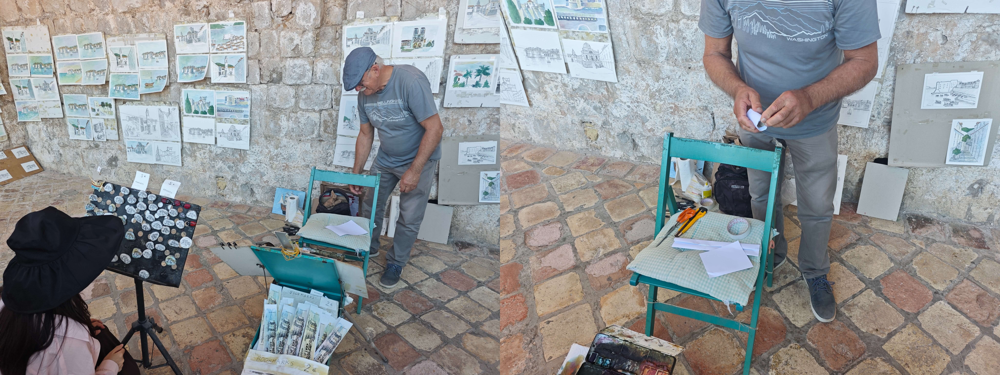

城墙转而向南，穿过皮勒门 *Pile Gate* 后已经可以遥遥望见海面。昔日的瞭望窗应该自己也没想到，几百年后能成为游客打卡出片的道具。向西眺望还能看到洛夫里耶纳茨要塞 *Tvrđava Lovrjenac*，这是一个独立于老城城墙的独立堡垒。走到城墙最南端后，经过一个上坡转而向东，向外看是茫茫的亚得里亚海，向内看可以观察不同人家的庭院或者阳台，偶尔会出现一只正在伸懒腰的猫。因为城墙南边景色好，时不时就会路过一家酒吧。更神奇的是，往下眺望嶙峋的海岸岩石时，能看到有两三处地方簇拥着穿着泳衣的人群，老外们扎堆往海里跳水。事后查阅得知，这里是著名的布扎 *Buža* 悬崖跳水点，和开在海崖上的露天酒吧  *Cold Drinks Buža* 一同运营。

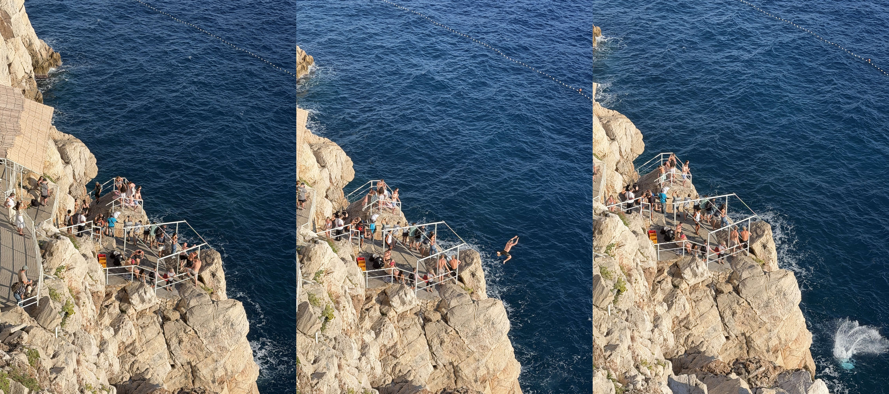

## 晚饭

我们绕了几乎一整圈，大约 $16:50$ 从普洛切门南侧的一扇幽静的小门下城墙，共计一个半小时。穿过一片幽静的小巷后逐渐有了烟火气：餐馆开始把桌椅摆出来，有些游客已经落座，隐约能闻到酒香和食物的香味。

我们正好补打卡了刚开门的圣布莱斯教堂 *Crkva sv. Vlaha*。教堂规模有点小，我俩有点审美疲劳。

我们把晚饭定在了西门，不得不再次横穿老城。主街上有一家 *BANAITO*，下午经过时我就看到很多游客拿着一盒香蕉（油炸？冰镇？）在吃，馋虫上身就缠着励颖去体验一把。我清楚地记得价格牌上第一行是 *Frozen Banana* $4.9$€，下方则是各种看不懂的口味。于是我把第一行念给店员听，当她往冻香蕉上涂巧克力的时候我还没意识到事情的严重性。结账时男店员不动声色地给我输了 $9.9$€，我连忙把信用卡收回手上，磕磕绊绊地给他解释说我只要了 $4.9$€ 的冻香蕉。店员笑眯眯地解释说，如果涂了巧克力，这种口味就是 $9.9$€ 了。没办法，只能硬着头皮结账了。这下好了，一整天里甚至是一整个克罗地亚行程里，我都要遭受励颖的嘲笑。冻香蕉的口味蛮独特的值得一试，但上面的巧克力就有点多余了（主要是我本来就不喜欢吃巧克力），我一直墨迹到晚饭期间才全部吃完。

猫头鹰石位于方济各会修道院的外墙。它是一块从墙面探出的石雕滴水嘴 *gargoyle*，原本的功能是把修道院屋顶的雨水引离墙面排出去。因为外形像一张猫头鹰的脸，被当地人叫作猫头鹰石。杜城流传最广的说法如下：

> 如果你能站上猫头鹰石并保持平衡（有的版本要求单脚站立、同时还要脱掉上衣），你就会收获爱情、很快结婚，或者找到属于你的幸福。

这个民间传说在几百年来引来无数游客和当地人挑战，石头表面已经被踩得光滑发亮。我去小小挑战了几次，跳上去稍微站几秒钟是很轻松的，但是斜面太光滑没法一直维持着。

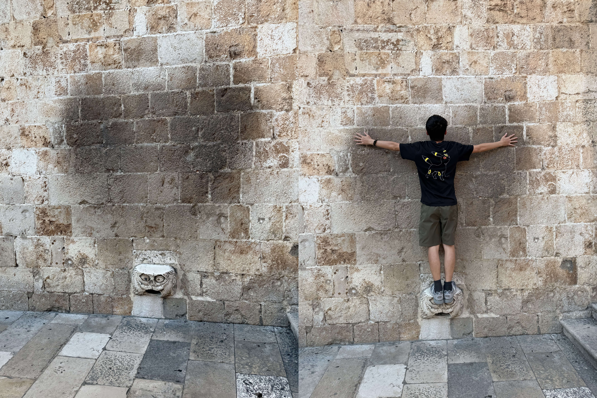

晚餐预订在 $17:45$ 的 *Dubravka 1836 Restaurant & Cafe*，我们提早了 $15\min$ 抵达。这是山顶那家店在老城的分店，上午获得的九折券可以在这里核销。励颖帅气地订到了 *First Row*，即我们可以靠在墙边欣赏落日海景。美景带来了高额的溢价，我们根据小红书的推荐，点了 $34.2$€ 的焗烤牛肉里脊 *Gratinated beef fillet*（附送了一份带有烤青椒、蘑菇和茄子的蔬菜盘）和 $23.9$€ 的烤鱿鱼 *Squid - grilled*，九折后共计 $52.29$€。即使作为资深鱿鱼迷，要不是攻略里强推，这个价位的鱿鱼着实不忍心点；结果等菜端上来后，励颖发现这盘鱿鱼味道非常好，摇身一变也变成了鱿鱼爱好者。为了尽可能拖到 $18:30$ 看日落，我们吃得很慢，焗烤牛肉里脊冷掉后就少了点风味。

皮勒门公交站点的售票亭可用 *Dubrovnik Pass* 领取同时长的公交票，即我们会获得以激活时间为始的 24h 通票，单买的价格是每张 $5.31$€。**杜城糟糕的 APP 再次给我留下了深刻的印象**。其公交系统没有对接 Google Maps，需要下载当地自研的 Libertas App 查看；Google Play 再次表示这个软件太老无法安装，我只能再次通过 APKPure 下载；安装后发现该 APP 只提供静态线路系统+车辆实时通报两个功能，没有和地图有机结合——即我只能一边用 Google Maps 导航，一边手动映射到 APP 里对应坐标的位置来搜寻对应的车站和公交线路。

为了前往 *Ul. Đura Basaričeka 2* 的民宿，我们需要搭乘 1A/1B 从 *Pile* 始发站坐到 *Placa Gruž* 站，再沿着山坡步行七八分钟。到达站就是格鲁兹集市，虽然市场早就散了，周围还有很多面包店和便利店开着，包括常见连锁超市 *Studenac Market*。调研了一下这个平价超市的定价逻辑，和上一次欧洲之旅的印象吻合：鲜奶便宜而纯净水贵，而且瓶子越小单价越贵（如 jana 纯净水 1.5L 售价 $1.22$€，1L 售价 $1.05$€）。买好水和物资爬上坡后，猛然发现民宿边上还有另一家连锁超市 *Tommy Supermarket*，而且看起来商品价格更低一些= =。

## 格鲁兹集市

原计划早起到格鲁兹市场 *Gruž Market* 去看看，结果稍微赖了会儿床。清晨的杜城别有一番色调，淡蓝色的海天和红色的屋瓦很配。 带着 $30$€ 大额现金出发，$8:30$ 抵达市场，发现很多摊位已经空了。外侧摊位卖的是鲜花和蔬果，屋里的摊位卖的是海鲜。这些食材很适合在民宿长住的游客，隔两天来市场进个货，在民宿里自个做个饭，食材新鲜且实惠。我们逛了一圈没发现有意思的东西，啥都没买。打卡了市场边上有名的肉饼店 *Fast Food Turist*，牛肉馅饼 *burek* $4$€ 一个。我觉得味道正常，励颖则觉得非常好吃，把一整个饼都吃了个精光。

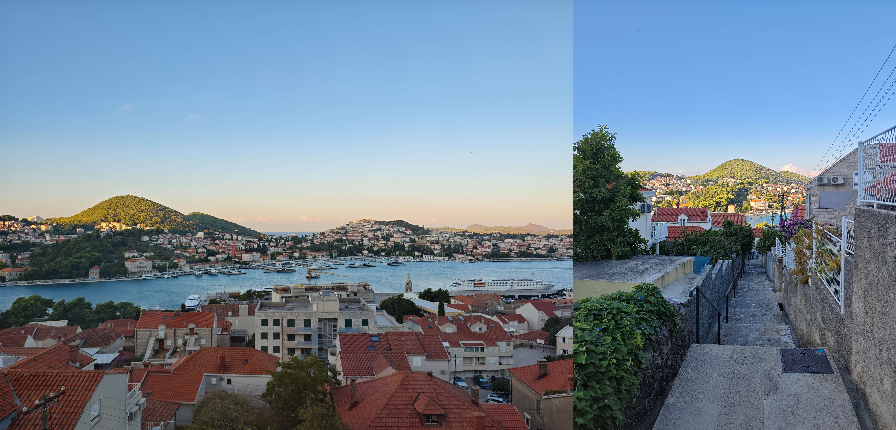

从市场折返后，我们回民宿收拾好行李，Uber 打车到汽车总站寄存，再慢悠悠地公交去老城。

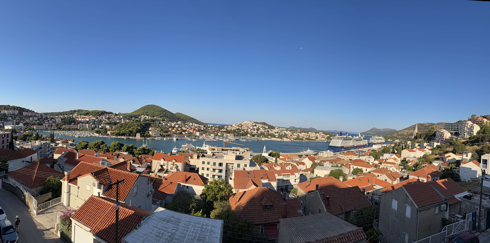

## 再去老城

前一天城墙下来晚了，洛夫里耶纳茨要塞 *Tvrđava Lovrjenac* 已经关闭了，这次正好在 Daily Pass 范围内补上。这座堡垒不在城墙内，而是孤悬在老城西侧 37 米高的海蚀悬崖上，扼守从海上进城的唯一通道皮勒湾 *Pile Bay*，被誉为 **杜布罗夫尼克的直布罗陀**。14 世纪初，威尼斯人计划在这块悬崖上建要塞，借此卡住杜布罗夫尼克的咽喉。拉古萨人得知后抢先动工，传说仅用数月就建成。此后数百年它不断加固，是共和国西面防线的核心。

下面这两张天空格外蓝的照片是我拍的，励颖吐槽我的手机原相机带了滤镜。

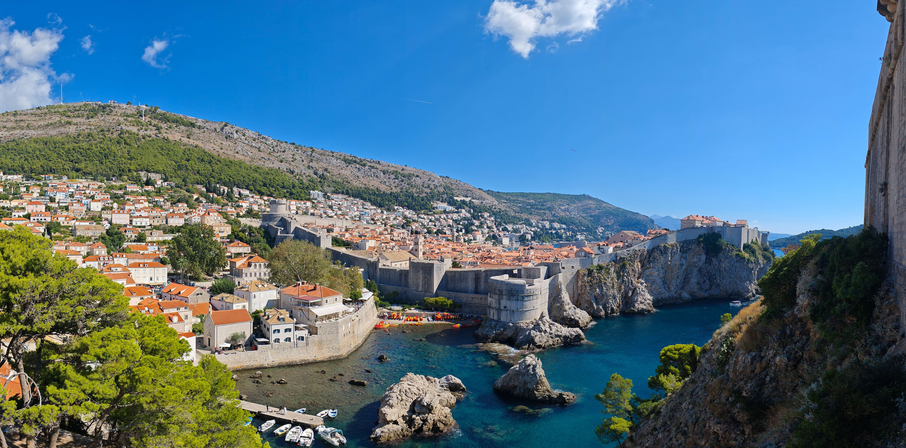

堡垒大门上的铭文写了 “纵使金山来换，自由绝不售卖” *NON BENE PRO TOTO LIBERTAS VENDITUR AURO*。这句拉丁铭文是拉古萨共和国的精神宣言， *Libertas* 一词至今印在克罗地亚国旗旁的杜布罗夫尼克城徽与旗帜上（公交 APP 里也有体现）。内部是一座座相连的石砌炮室，拱顶结构。朝海的墙壁厚达 12 米，只在高处开有窄小的射击窗；朝城一侧的内壁却只有60厘米厚——据说是为了防止要塞被敌人占领后用来反攻老城，城里的大炮可以轻松把它轰塌。顶层是架着几门老铁炮的平台，视野非常好，整个杜布罗夫尼克老城的红屋顶和城墙尽收眼底。

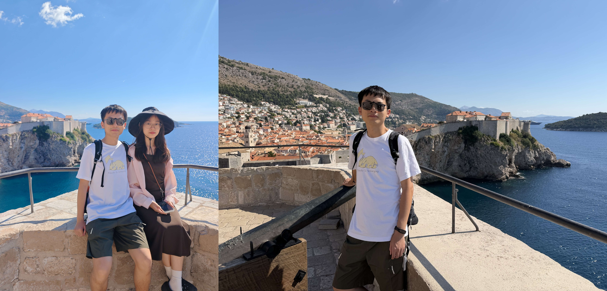

从要塞下来励颖直奔 *Dubravka 1836 Ice Cream*，这是昨晚就餐的饭店在临街开的冰激凌店，三球 $6$€ 很实惠。励颖评价和普洛切门入口的 *peppino's gelato* 口味接近，现在看来后者的两球 $7.5$€ 实在是太宰客了。

当天的午饭没有攻略安排，我们就漫无目的地在老城的小巷里穿梭。我刚在和励颖吐槽“欧洲的饮食吃腻了，有点怀念鸡翅，但估计老城里找不到这种店”，结果一转头就闻到一股汉堡炸鸡的味道。这是一家叫做 *Surf'n'Fries* 的克罗地亚本土的快餐连锁品牌，菜单包括薯条、炸鸡、汉堡、三明治、卷饼等，主打价格亲民。我们点了份标价 $10$€ 的 *Crispy Chicken Wings Menu*，内含五个鸡翅根和一份薯条（另有七个鸡翅根的等价套餐），用标志性的锥形盒子盛放，每张桌子可以配套插入尖角。实际刷卡时只付了 $7$€，我这才发现桌上有一块 *Discount 30%* 的牌子，果真是价格亲民啊！我们随后遇到一个问题，店里所有的桌子都坐有人，而拿到外面边走边吃也不太礼貌。这时一对老夫妇见状主动邀请我们过去 share 桌子，我们就这么聊起天来：他们来自美国，提到有位（中国）朋友在黄石国家公园玩；我们给他们分享了逛城墙的经历（要上上下下爬楼梯）和下午去斯普利特的规划。

饭后我们卡好时间坐 1A/1B 从 *Pile* 始发站坐到 *Kantafig* 站，这里就是杜城的汽车总站。隔壁有一家名为 *Konzum* 的大型超市，在这里我调研到了全城最低的物价，锚定物 jana 纯净水 1.5L 售价仅 $0.99$€，正好买一点补给品带上大巴。我预订的是 $14:45-18:50$ 从杜城去斯普利特的 FLIX BUS。欧洲的火车或大巴真的是越早订越便宜，早前在携程预订的时候两个人只需 $202$¥，出发前购买（即使在人民币汇率走强的情况下）已经上升到 $350$¥ 了。汽车总站的官方寄存处，一份行李每一小时收费 $1$€，只收现金。这个价格初看还算合理，**细想之下非常昂贵，侧面衬托出这个网红城市的高物价**。我们只寄存了四个小时，两个行李箱的总价是 $8$€，勉强能接受。

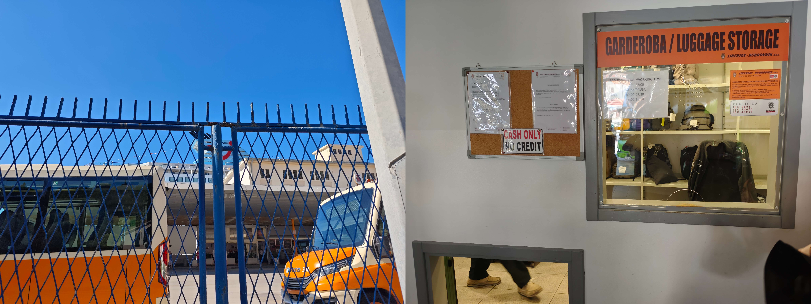
