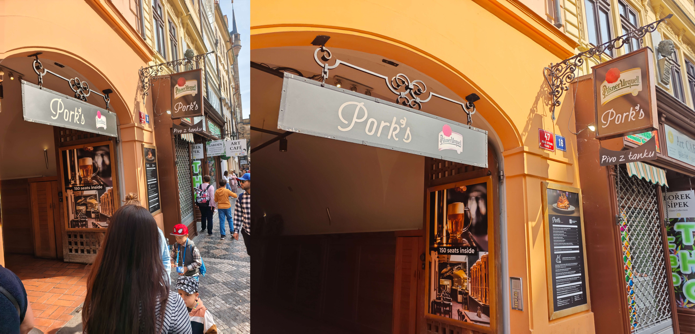

## 抵达当晚

我们乘坐克罗地亚航空 OU4324 $16:00-17:25$ 自克罗地亚斯普利特飞抵捷克布拉格，实际落地时间更早些。订了火车总站对面的埃克城市公园酒店 *Exe City Park Hotel*，不完全的交通资讯让我们落地后手忙脚乱了一阵。

- 最方便的方式是搭乘机场快线 *Airport Express* 直达布拉格火车总站 *Praha hlavní nádraží*（我们的酒店就在对面），但令人不爽的一点是自 2026 年 1 月起  AE 单程票价从每人 $100$CZK 上涨至 $200$CZK。
- 捷克私营公司 *RegioJet* 也提供机场段的运营，票价保持 $100$CZK 而且在微信小程序上就能购买。唯一的问题是其下车点是 *Hradčanská*，需要继续搭乘地铁 A 线摆渡，对于携 带行李箱的我们来说不太友好。
- 公共交通路线是 59 路公交+地铁 A 线+步行，单次票 $50$CZK（90 分钟）、24h 票 $150$CZK，主打一个省钱。

AE 和 *RegioJet* 是定时发车，Google Map 显示都有 $17:30$ 左右的班次，我就招呼励颖快步出机场。门口停着一排显眼的公交车，但就是没有大巴的影子。静下心来深入调研，我发现这些大巴需要在 Terminal 1 乘坐，而我们是从 Terminal 2 出站的。确认赶不上最近这一班后，我决定换成 59 路公交+地铁 A 线：掐指一算 24h 通票刚好符合我们的需求，每人 $150$CZK 就当是省钱了。布拉格也需要在机器上打卡，好在我们身经百战见得多了。

布拉格的傍晚有点寒冷，穿着短袖的我被狠狠上了一课，甚至有路人已经穿上了棉袄。这里同欧洲很多城市一样运营着有轨电车，但秩序完全不一样：**即使电车正从远处驶来，路人也会非常随意地穿梭电车轨道**。我们从 *Můstek* 出地铁，在瓦茨拉夫广场 *Václavské náměstí* 前拐弯，步行抵达埃克城市公园酒店。入住的城市税共计 $4.09$€，这个奇怪的价格应该是当地货币转欧元的汇率造成的。果然，事后搜到布拉格的城市税上限是每人每晚 $50$CZK。

当晚的就餐地点是 *Restaurace Hybernská*，我们换上了最保暖的一身出门。这家店分为上下两层座位很多，不过由于我俩是 walk in 的，还是得在门口等一段时间。此前我们已听说捷克的猪肉很有名，所以点了 $385$CZK 的烤猪颈肉排 *Grilovaná vepřová krkovice*，配上 $249$CZK 的牛肉可乐饼 *Krokety s hovězím*、$138$CZK 的百利甜酒焦糖炖蛋 *Baileys Crème Brûlée*、$119$CZK 的乐蔓蜜桃无酒精饮料 *Nealko Liefmans Peach*。从餐厅里气派的酒水单和欢乐的饮酒氛围中我们后知后觉发现：捷克是世界啤酒之国，人均啤酒消费量第一，百威和皮尔森的名字都源自这里。

餐后我们坐 $15$ 号电车前往查理大桥 *Karlův most*。查理大桥由查理四世于 1357  年奠基，六百多年来一直横跨在伏尔塔瓦河 *Vltava* 上，连接着老城与小城区。桥长 516  米，全靠 16 座石墩撑起连拱。桥面由巨大的砂岩石板铺成（布拉格至今流传着查理四世往灰浆里掺蛋黄的传说），当年卡夫卡、莫扎特走过的正是这几块石板。奠基时刻是占星师精心挑选的 1357 年 7 月 9 日 5 时 31 分——正读倒读都是 1-3-5-7-9-7-5-3-1 的数字回文,，查理四世相信这能保佑大桥永固。整个布拉格夜景里只有黄光，小城区和老城区的建筑上的灯光强烈而均匀，在查理大桥远眺伏尔塔瓦河时只剩下星星点点的黄光，这和武汉那种金碧辉煌的风格有着很大的区别。桥上的游客适中，行走间偶尔会遇到一个摊位，街头临摹画像、艺术表演或是售卖纪念品。桥上有三十尊巴洛克雕像，多为复制品（原作已收入博物馆），有些圣人下方有游客在排队抚摸，据说摸了 *St. John of Nepomuk* 雕像会带来好运。

布拉格的纪念品中，一只鼹鼠的存在感压过了查理大桥、天文钟和城堡的总和。这只鼹鼠叫 *Krteček*，捷克语的意思是"小鼹鼠"，1956 年由动画师兹德涅克·米莱尔创作，次年拿下威尼斯电影节银狮奖。全片几乎没有对白，情节靠动作和音效推进，不需要翻译。2011 年美国宇航员安德鲁·费斯特尔把一只小鼹鼠玩偶带上了奋进号航天飞机，所以 *Krteček* 是上过太空的鼹鼠。中国游客们在布拉格最津津乐道的话题就是**哪里买鼹鼠最便宜**，因为正版鼹鼠毛绒在捷克只有一家主力生产商，官方授权、按尺寸分档、货号统一。根据我们的调研结果，如果追求性价比优先，景区里最值得买的店包括：布拉格城堡区星巴克过道里的 *Discover Prague Castle*、布拉格城堡西边一位老爷爷经营的摇摆木马玩具商店 *Rocking Horse Toy Shop*、老城区 *Palladium* 商场负一层星巴克边上的小纪念品店。

穿过查理大桥回望，河面上密密麻麻排列着鸽子，游客一拍手就一群一群地起飞，我的密集恐惧症有点犯了。我们本来在考虑步行穿过布拉格老城区抵达酒店，但晚上的寒风实在吹得太冷了，不得不切入最近的电车站。

## 布拉格城堡

$7:30$ 的闹钟按过去了，挣扎到 $7:50$ 才起来。这次我们预订了带双早的套餐，自助早饭的空间不大但食物准备得很用心，超出我俩的预期。酒店的另一个便利之处就是前台免费提供寄存服务，可以安心出门游玩。

搭乘 23 号电车从 *Jindřišská* 站至 *Malostranská* 站，中途会穿过军团桥 *Most legií*，正好向北眺望查理大桥。

上午的目标是布拉格城堡 *Pražský hrad*。它与其说是一座城堡，不如说是一座建在山顶的城中城。整个建筑群东西绵延 570 米，占地约 7 公顷，被吉尼斯认证为世界上最大的古堡群。电车到站后，我们需要自东向西攀登。布拉格城堡始建于公元 880 年左右，由普热米斯尔王朝的博日沃伊王子奠基，此后一千年里始终是这片土地的权力中枢——波西米亚公爵、国王、神圣罗马帝国皇帝、捷克斯洛伐克和捷克共和国的总统，都把驻地设在这里。

布拉格城堡室外区域是免费开放的，建筑单独收费，最经典的联票称为主环线 *Pražský hrad – hlavní okruh*，包含四个景点：圣维特大教堂 *Katedrála svatého Víta*，旧皇宫 *Starý královský palác*，圣乔治大殿 *Bazilika sv. Jiří*，黄金巷 *Zlatá ulička*。票价 $450$CZK，有效期两天。从阶梯钻进甬道就到了城堡区的东边，这里没有安检门也没有售票处。继续向西是缓缓上坡的石板街，圣维特大教堂的尖塔在屋檐上方时隐时现，像个路标。

看到星巴克后我们就开始寻觅鼹鼠店，很快在走廊右侧发现一家纪念品店，鼹鼠们挤在一个竖着的柜台里。以标准的 $14\text{cm}$ 鼹鼠为例，这里不卖原味鼹鼠，带帽子、穿背带裤、带帽且穿背带裤三者的价格统一都是 $429$CZK。这批价格略高于小红书攻略里 $3$ 开头的价格，我们一度以为找错了店，在附近晃悠半天+高强度搜索近期帖子，方才确认是这家店涨价了。捷克的国旗是红蓝白三色，所以这种配色的帽子肯定具有最优纪念价值。励颖喜欢穿着背带裤的，而我喜欢裸身的（背带裤粘在身上制作，没法取下来），最后以她的意见为准买了份 $14\text{cm}$ 的。

圣维特大教堂 *Katedrála svatého Víta* 是捷克最大的教堂，也是布拉格城堡的主角。1344 年由查理四世奠基，工程先后经过两代建筑师之手，修了停、停了修，前后拖了将近六百年，直到 1929 年才正式完工。教堂东半部是纯正的 14 世纪哥特式（上图），西侧立面（下一图）和双塔则是 19 世纪的新哥特式续建，是如今游客进出的地方。南面（下二图）正中间的三道拱门叫金门 *Zlatá brána*，上方闪闪发亮的是 14 世纪威尼斯工匠制作的《最后的审判》金色马赛克，画面中跪着的是查理四世夫妇。大南塔 *Velká jižní věž* 高约百米，下半截哥特式，塔顶却扣着一顶 18 世纪的巴洛克绿铜盔。设计师原本设计了南北双塔，但 15 世纪胡斯战争打断工程，北塔永远停在了图纸上；等 19 世纪续建时，方案改成了西立面双塔。**非常可惜的是圣维特大教堂周日要礼拜**，游客开放时间延迟到 $12:00$，而我们这个点预约了午餐就没法折返进入内部欣赏。大南塔共 287 级台阶，$200$CZK 单独售卖登顶门票，是俯瞰布拉格全景的最高点。由于布拉格城堡的高地势足以眺望全城，我们就没有去登顶。

我们意外在教堂西北侧找到一家名为 *Česká pošta* 的邮局，分为两小间。一侧是标准的邮寄窗口，售卖明信片和寄送用的邮票，有一张小桌子可以写信；另一侧空间更大，用玻璃柜展出了一些邮票，主打的是收藏。我的老毛病犯了，照例购买两枚明信片一份国际通行的 Z 邮票 共计 $74$CZK，明信片一份贴邮票寄回去一份带回去。我们一走进隔壁房间，柜姐就滔滔不绝向我们介绍这里的产品，听说我们不是专业邮票迷就掏出一本小收集册让我们看是否有喜欢的，我们就挑了一套两份的 $80$CZK 邮票用于纪念。和小红书里说的一样，柜台前有两个印章可以敲，上面的花纹我们在窨井盖上看到过类似的。门外的邮筒是蓝色的，据说全布拉格只此一个蓝色邮筒。

旧皇宫 *Starý královský palác* 是晚期哥特式世俗建筑的巅峰之作。

- 弗拉迪斯拉夫大厅 *Vladislavský sál* 是旧皇宫的核心空间，建于1493-1502 年。大厅长 62 米、宽 16 米、高 13 米，不用一根柱子撑起这么宽的石拱顶。最醒目的是头顶的晚期哥特式肋拱：拱肋不再按几何规律分格，而是自由弯曲交织，几乎像藤蔓一样爬满整个顶面。侧墙开的是方正的文艺复兴式矩形窗，外侧还保留着哥特式的"驴背形"拱，两种风格在同一空间里衔接。这里曾是波西米亚国王加冕宴会的举办地，场地大到能容纳骑士骑马入内比武。角落有一组独特的骑士楼梯，坡度平缓宽阔，全副武装的骑士可以骑着马直接进入大厅。
- 大厅周围有几间办公用房，桌椅陈设简单。一间摆着文艺复兴时期的绿色瓷砖火炉，是冬季取暖的实物遗存。有一间是宰相府 *Kancelář*，这里发生过第二次布拉格掷窗事件：1618 年 5 月 23 日，新教贵族在宰相府的房间里把两名王室总督和一名秘书从窗户扔了出去，三人掉进城堡壕沟奇迹生还（天主教说是天使托住了他们，新教徒说是因为掉进了粪堆）。这一扔直接引爆了三十年战争，欧洲死亡数百万人，波希米亚随后被哈布斯堡王朝彻底控制，捷克贵族阶层被清算，德语成为官方语言，捷克文化沉寂了近两百年，即所谓"黑暗时代"。

- 尽头的议会厅 *Sněmovna* 里布置着红色长椅和高背宝座，是 19 世纪重修后的内饰，波西米亚地方议会曾在此议事。厅旁陈列着捷克加冕宝器的复制件——圣瓦茨拉夫王冠、权杖与宝球。真品锁在圣维特大教堂的加冕珍宝室里，密室的门有七把锁，分别由共和国总统、总理、布拉格大主教、众议院议长、参议院议长、大主教座堂教长和布拉格市长保存，同时到场才能开。王冠极少示人，只在国家最重大的时刻展出。

圣乔治大殿 *Bazilika sv. Jiří* 是布拉格城堡内现存最古老的教堂建筑，920 年由弗拉季斯拉夫一世建立，973 年扩建为本笃会修道院教堂，即波西米亚第一座修道院。如今看到的红色立面是 17 世纪增建的巴洛克外壳，与内部的罗马式本体完全是两个时代。走进内部，石灰岩砌成的简素墙体、半圆形拱券、平顶的木结构天花板，是典型的罗马式做法，与隔壁圣维特大教堂的哥特尖拱形成直接对照。中殿尽头的高坛绘有中世纪壁画残迹，半圆形后殿的天顶画描绘圣母加冕。侧墙上嵌着大幅哥特晚期祭坛画。大殿是普热米斯尔王朝的家族墓地：创建者弗拉季斯拉夫一世葬于右侧的墓龛，他的母亲圣卢德米拉（波西米亚第一位殉道圣人）的石棺也在殿内。

黄金巷 *Zlatá ulička* 夹在城堡北墙的防御廊道与外墙之间，是 1597 年鲁道夫二世时期为城堡卫兵和射手修建的一排小屋。小屋依城墙而建，进深极浅、门低窗小。之所以得名“黄金巷”，传统说法是 17 世纪这里有金匠聚居，更浪漫的说法是鲁道夫二世的炼金术士曾住在这里炼黄金。19 世纪城堡卫队撤走后这里变成了布拉格最穷的人住的地方。1916 至 1917 年，卡夫卡借用妹妹奥特拉租下的 22 号小屋写作，《乡村医生》等短篇在此完成。20 世纪 50 年代巷中所有住户迁出，政府把巷子整体修复、刷上彩色，店面用于复原陈列或改为纪念品店。

中午我们面临两个相反的选择：沿着原路下阶梯，按原计划 $12:00$ 的预约时间去城堡东南面 *Pork's Mostecka* 吃午饭；放弃预约，先进入圣维特大教堂内部逛逛，再沿着城堡西面下山去 *Rocking Horse Toy Shop*。民以食为天，最终我们选择了前者。下山的阶梯上明显热闹了许多，游客和摊位都变多了。

## 午后的小城区

路过华伦斯坦花园 *Valdštejnská zahrada*，它位于小城区的城堡山脚下，是 17 世纪华伦斯坦将军修建府邸时配套的几何式园林。他是三十年战争中的帝国军统帅，靠战争积累成为波西米亚首富，买下大片地产建起这座府邸，却因被怀疑通敌遭皇帝解除兵权并刺杀。花园如今作为捷克参议院 *Senát* 的花园免费开放。中心是一方大水池，池中喷泉立着赫拉克勒斯搏龙的铜像，出自文艺复兴末期雕塑家阿德里安·德弗里斯，原件存于瑞典，池中是复制品。

*Pork's Mostecka* 的人气很高，偌大的店面里坐满了顾客。除了招牌的 $479$CZK 烤猪肘 *vepřové koleno* 外，我们补点了一份 $139$CZK 啤酒冰淇淋 *Pivní zmrzlina s karamelovou šlehačkou*（感受下捷克的啤酒）。猪肘配菜包括芥末、辣根和脆酸菜，外皮烤成带泡的焦脆壳，咬下去咔嚓作响，非常好吃；啤酒冰激凌有点像绍兴老家的黄酒冰激凌。结账时我选择了 $10\%$ 的小费（**这趟欧洲之行里我们唯一给的小费**），服务员很开心地送了我们两杯小甜啤酒。

*The Pork's* 对面就是网红的烟囱甜甜圈店 *Trdelník - Sweet Chimney Cake*。*Trdelník* 是指把面团缠在木棍上烤成的中空"烟囱"，外壳焦糖酥脆、内里柔软，里面有灌奶油和灌冰激凌两种方案。这种"木棍烤面圈"的做法真正的老家在匈牙利，学名 *kürtőskalács*，已有几百年历史。价格着实不低，我们选的开心果碎冰激凌的价格高达 $190$CZK。开心果冰激凌的口味很标准；面包本身好吃，外脆内韧，但甜度爆表，吃到最后有点齁。

午后我们重走昨晚那条路，自西向东穿过查理大桥，桥面上游客和摊位多了很多，摊位清一色地靠在南面，依然是街头速写、艺术表演和售卖纪念品三足鼎立。回望小城区能看到一高一矮两座塔：矮的是犹滴塔 *Judith Tower*，12 世纪罗马式，原是更早的"犹滴桥"（1172 年建成，1342 年被洪水冲毁）的遗存；高的是小城桥塔，1464 年仿老城桥塔的样式建造的哥特式塔。阳光下伏尔塔瓦河面被照得发亮，远处布拉格城堡的红屋顶层叠着伸向天际，和夜晚的黄光朦胧完全是两个世界。桥中央的圣约翰·内波穆克 *St. John of Nepomuk* 雕像前依然排着队，我们入乡随俗地摸了小狗和坠河的约翰，传说摸狗能保佑忠诚与好运，摸约翰坠河的身影则保佑你将来重返布拉格。

往老城方向望去，视线尽头是黑沉沉的老城桥塔 *Staroměstská mostecká věž*，和大桥同龄，建于 1370 年代。哥特式塔身上雕着查理四世父子和捷克双尾狮徽章，被称作欧洲最美的哥特式桥塔。塔左侧一抹绿色圆顶是圣方济各教堂，铜绿穹顶和黑塔撞出布拉格天际线最经典的配色。穿过塔下的拱门就是老城了。

## 老城区

老城区第一站是 *Man Hanging Out*，这是位于 *Husova* 街与 *Skořepka* 街交叉口的调皮的雕塑。一位西装革履的老先生正单手挂在七八层楼高的房檐外，另一只手插在口袋里。这是捷克"捣蛋鬼"艺术家大卫·切尔尼 *David Černý* 1997 年的作品《上吊者》*Viselec*，被吊起来的人是心理学鼻祖弗洛伊德。有解读说这象征知识分子在现代社会中悬置、疏离、冷眼旁观的处境，也有解读说这是切尔尼对"弗洛伊德本人如何看待自己的死亡恐惧"开的玩笑。糟糕的是雕塑南侧有一幢大楼正在施工，拍照时绕不开这个背景，我们不得不走到南侧向北拍雕塑的背影。

第二站是哈维尔集市 *Havelské tržiště*。这是布拉格从 1232 年营业至今的露天市集，中世纪时这里是日耳曼商人和手工业者的地盘，八百年来摊贩的叫卖声换成了十几种语言，如今售卖水果和纪念品等。集市尽头有一对“绿色洋葱头双塔”，那是圣哈维尔教堂 *Kostel svatého Havla*。它和集市同龄（正好商人在外面数完钱进去就能忏悔），如今的样子是 17-18 世纪巴洛克重建的结果。市场里捷克克朗和欧元同时流通，换算比例约为 $1:25$。

集市里有一家很大的玩具店 *Hračky U Krtečka*，可以领略到大量捷克的传统玩具，相当一部分都是木制品。这里的鼹鼠品类非常全，以 $14\text{cm}$ 的标准款举例，这里会根据带什么帽子、是否穿背带裤而精确标定不同的价格，其中背带裤款比城堡星巴克纪念品店略贵。鼹鼠瘾上来了，我们继续争论买什么鼹鼠，励颖像着了魔一样想再入一只背带裤，而我执意不想要裤子。讨论结果是来都来了，升格成 $691$CZK 的 $20\text{cm}$ 大鼹鼠，带着捷克国旗颜色的帽子。木质冰箱贴的价格非常实惠，款式非常走心（不像大街上那种批量印刷品），我入了个 $42$CZK 的布拉格电车。

北面不远处是 *Old Prague souvenir*，一家驰名小红书的纪念品店。店员热情地给我们分发小篮子，看到我们的长相后口中循环念着“小红书”的中文读音。当我们指着外侧墙上的冰箱贴问价时，店主又重复着“99”的中文读音。怪不得小红书上都建议来这里买天文钟的冰箱贴，因为这里款式齐全，而且无论大小一律卖 $99$CZK。我们仔细观察了天文钟原始的样貌（上一个圈是淡蓝配红色，下一个圈是淡黄色），以此挑选了一个高度还原的天文钟冰箱贴。结账时我提出用欧元支付，店员以 $1:24$ 按计算器，并主动帮我抹零 $0.125$€，以 $4$€ 成交。

老市政厅天文钟 *Pražský orloj* 装在老城广场东侧的市政厅南墙上，1410 年由钟表匠米库拉什制成，是世界第三古老的天文钟，也是仍在运转的钟里最古老的。钟面分为两层：上层的天文盘中心是地球，金色太阳指针同时读出三种时间，包括罗马数字环的现代中欧时间、外圈哥特数字的"捷克旧钟时"（日落为一天起点）、不等长小时的巴比伦时，黑色指针则指示月相和月亮位置；下层的日历盘是 1490 年前后加装的，1866 年画家约瑟夫·马内斯在十二格圆盘里按月画上波西米亚的农事场景。我们卡在 $15:00$ 抵达天文钟，钟下已聚满了游客。钟上方两扇小窗会打开，十二使徒木偶依次转出，两侧的四尊雕像随之动作：骷髅"死神"摇铃翻转沙漏，对面是拿镜子的"虚荣"、晃钱袋的"吝啬"和弹曼陀林的"享乐"，寓意中世纪的四种警世主题。

老城广场 *Staroměstské náměstí* 是布拉格的心脏，12 世纪起就是市集所在，难怪《核子激荡》桌游里算双倍分。

- 广场中央的青铜群雕是扬·胡斯纪念碑 *Pomník mistra Jana Husa*，于 1915 年胡斯殉道 500 周年时揭幕。胡斯是 15 世纪的宗教改革先驱，因批判教会腐败于 1415 年被火刑处死。基座上刻着捷克的国家格言 *Pravda vítězí*，意为真理必胜。广场的宗教冲突史不止于胡斯：1621 年白山战役失败后，27 名新教贵族和市民领袖在市政厅前被公开处决，今天广场地面的石板里还嵌着 27 枚白色十字标记。
- 泰恩圣母教堂 *Kostel Matky Boží před Týnem* 由两座约 80 米高的黑色哥特尖塔组成，从 14 世纪立起，一粗一细，被戏称为"亚当与夏娃"。左前方的圆柱是圣母柱 *Mariánský sloup*，原柱建于 1650 年，是欧洲最早的圣母柱之一，1918 年捷克斯洛伐克独立时被人群当作哈布斯堡象征推倒，后在 2020 年复原重建。复原的圣母柱落成时仍有争议，不少布拉格人认为它代表天主教复辟而非城市历史。
- 圣尼古拉教堂 *Kostel sv. Mikuláše* 是绿顶巴洛克建筑，1730 年代建成，由小迪岑霍费尔独立建造。胡斯战争后它成了胡斯派教堂，如今归属捷克斯洛伐克胡斯教会，也是老城教堂音乐会的常用场地。

从布拉格广场回酒店时会经过火药塔 *Prašná brána*，这是老城东侧的哥特式城门，1475 年开建，原本是皇家加冕游行进入老城的起点，得名于 17 世纪储存火药的用途，目前是布拉格 13 座城门中仅存的一座。

因为是出申根的航班，我特意提前三小时抵达了机场，正好让 24h 通票站好最后一班岗。**布拉格机场是此行里最值得喷的场所**。海关排队时初见端倪，自助通道只能识别欧洲护照（这是现在欧洲机场通病）得走人工通道，但几条人工通道里只有一名工作人员维持秩序，排队的空间狭小而混乱，有游客因为插队而发生争吵。排了 $40$ 分钟队出海关后我们没有意识到事情的严重性，拖着行李逛了会免税店。还好我们逛累了想先去登机口放行李休息，走一半路后猛然发现前面排起了长队：**原来布拉格机场把非申根去安检口规划在登机口前**。队伍移速很慢，我们的心态很快从“有没有多余的时间逛免税店”变为“能否顺利赶上飞机”。我特意跑去安检口前张望，大批游客簇拥在前想利用催促登机的理由进入，被工作人员拦下说必须排队。唯一的安慰是我随机询问了队伍里的几名游客，大家都是同一航班，这样我们的心态又从“能否顺利赶上飞机”变为“需要延误多久起飞，会不会耽搁去伊斯坦布尔的转机”。

事后回想，这种糟糕设计的弊端包括：需要分散建设很多安检口，每个安检口就只能腾出一台机器和一条通道；同一登机口的游客往往是相邻时间过来，很容易一起拥堵在安检口前；游客无法安心在免税区购物，时不时就要注意排队进度。土耳其航空的硬件设施让我们的心情恢复了不少，屏幕是我在大飞机里用过的最丝滑的。
