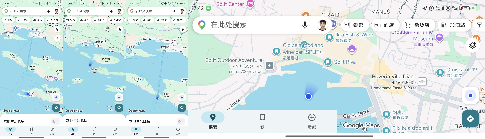
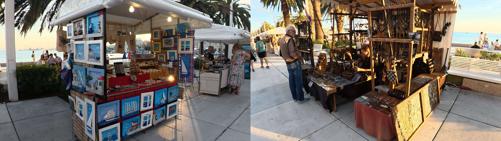
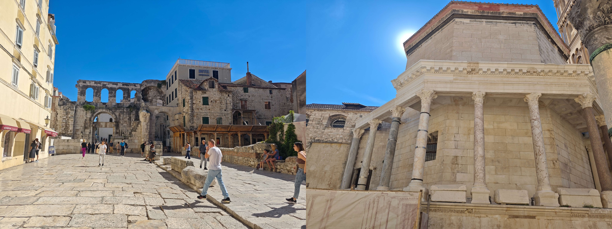
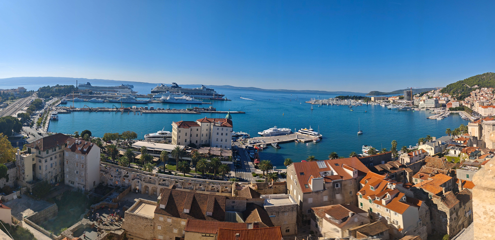
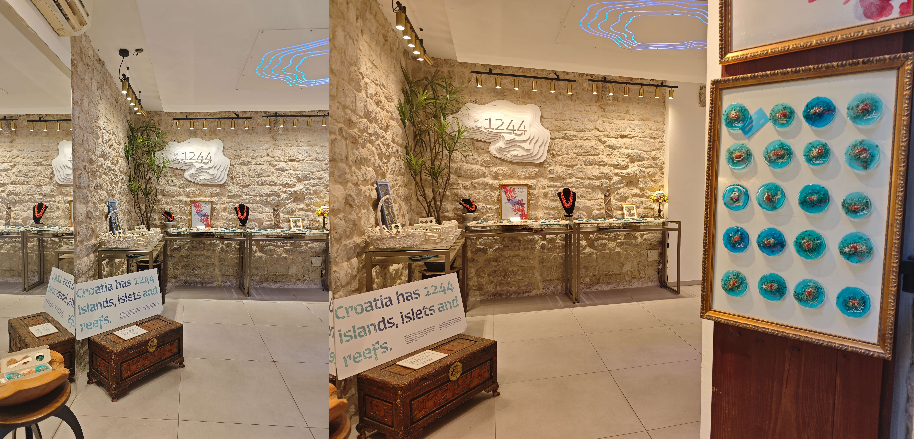
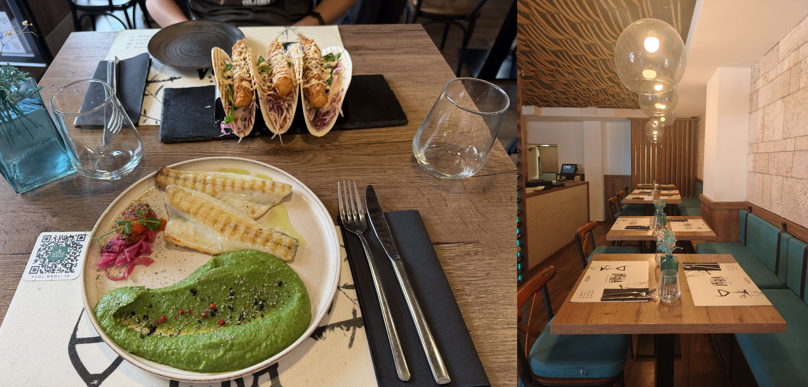
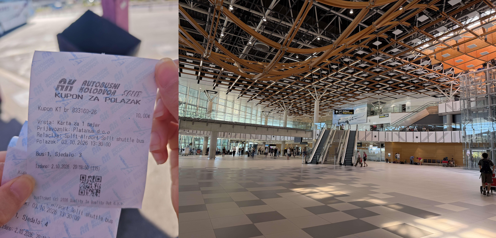

## 抵达

从杜城坐大巴至斯普利特，抵达时间比预计早一小时。我们订了位于 *Omiška ul. 19* 的爱彼迎民宿，同样得拖着行李步行十分钟到高处。民宿就在一楼，内部的家具非常现代化，软装的细节也很到位。窗外偶尔会传来汽车路过或者小孩玩耍的噪音，好在晚上休息时没有被打扰。

放完行李后我们就直奔 *Ikra Fish & Wine*，这是位于戴克里先宫内的一家海鲜餐馆。我们点了 $25$€ 的 *Ikra* 招牌拼盘 *Plate "Ikra" (for two)* 和 $17$€ 的鱼雷虾塔可 *Torpedo shrimp tacos*，两者的口味都远超我们的预期。我更偏爱招牌拼盘，金枪鱼塔塔配鱼籽非常鲜，鳕鱼丸子炸得很嫩很好吃，咸咸的凤尾鱼有种特殊的口感，把它们涂在脆脆的面包片上更是风味十足（图片里从左到右依次是亚得里亚海醋渍凤尾鱼 *Adriatic marinated anchovies*、鳕鱼炸丸子 *codfish fritters*、鱼肉酱 *fish paté*、金枪鱼塔塔 *tuna tartare*）；励颖更偏爱鱼雷虾塔可，虾肉很 Q 弹、外壳炸得很脆，底下的时令沙拉、香脆干洋葱和新鲜青柠碎混合得恰到好处。结账时店员告诉我付现金有 $10\%$ 的折扣——不禁让我联想到上次欧洲之行发现信用卡有 $13\%$ 手续费——可惜我们没有带足够现金出来。

我们总是容易绕到一个广场，咨询 Kimi 后得知是布拉奇·拉迪奇广场 *Trg braće Radić*，斯普利特人亲切地称之为水果广场 *Voćni trg*，因为从前农民就在这里摆摊卖水果。门前立着马尔科·马鲁利奇 *Marko Marulić* 的铜像，克罗地亚雕塑大师梅什特罗维奇 *Ivan Meštrović* 于 1925 年打造。马鲁利奇是"克罗地亚文学之父"：1501 年他用民间的查卡夫方言写成史诗《尤迪塔》*Judita*，是第一部用克罗地亚语写成的长篇诗歌，地位相当于但丁之于意大利语；他还在一篇论文标题里首次使用了"心理学" *Psichiologia* 这个词。**我们发现他的脖子上系着一条硕大的红领巾，经查这是克罗地亚的经典习俗**。领带最初就是克罗地亚人发明的，17 世纪的三十年战争期间克罗地亚雇佣兵系着红围巾为法军作战，法国干脆用"克罗地亚人" *Croate* 给这种领巾命名，所以领带的法语是 *cravate*、英语是 *cravat*。

晚间我们沿着海滨长廊 *Split Riva* 逛，两侧的摊位出售冰箱贴、薰衣草和饰品等小商品。值得注意的是，这些商品没有中国义乌制造的那般廉价感和批发感，能看出来很多都是摊主手工制作的。印象深刻的是一家海绵店铺，稍一驻足，店家便滔滔不绝地用英语为我们讲述海绵的制作原理和功效，强调这些海绵只经过了物理脱水是纯天然的。不同的篮子里装了不同大小的海绵，我很好奇它们各自的用途，摊主介绍说最大的用于洗车、中等的用于洗澡、最小的用于洗脸。海绵的价格颇为昂贵（这里的路边摊已经算实惠了），我们只买了个 $6$€ 的小海绵。

## 跳岛-蓝洞

我们提前在 GetYourGuide 预订了[斯普利特跳岛-五岛游](https://gyg.me/vwN5pYfL)，双人原价 $1950$¥，新用户九折优惠后是 $1755$¥。五岛游是最深度、最辛苦的一日团，前一晚收到邮件通知 $7:00$ 就会发船，即我们 $6:40$ 就得从民宿出发。集合地点是海边的 *Republic Square*，正好要穿过整个戴克里先宫。邮件里提到欢迎大家带上 Snack 和 Drink，但我俩只有一大瓶水没准备零食。戴克里先宫东门开着的一家 *Mlinar* 救我狗命，价格很亲民，买了两个面包花了 $2.5$€。

早上总共集合了两艘船的游客，每艘船分配 $10 \sim 12$ 名游客，很可惜我们没有被分配到网红导游 *Simon* 的船上。安全措施比国内宽松太多，明明是高速行驶的冲锋艇，却不用穿救生衣不用系安全带。上船后我意识到忘记吃晕船药了，其实也不知道自己是否晕船，匆匆忙忙兑水吞了一颗。我们的第一站就是著名的蓝洞 *Modra špilja*，这是比舍沃岛 *Biševo* 的一个天然海蚀洞，特许运营方是科米扎航海中心 *Nautički centar Komiža*，每天早上 $8:30$ 前会根据海况公布蓝洞是否开放。开船时向导告诉我们当天天气好，蓝洞开放的概率很大。

快艇在大部分时间是匀速行驶，不怎么晃。但向导有时候会刻意地加速、抬高船头或转向，这样整艘船会重重地砸在海面上，造成一段短时的失重。如果快艇连续撞击海面，我就紧紧地握着栏杆，反观励颖在风中大笑着说好爽。只要快艇在海中高速行进，向导就会放一些摇滚类的歌曲（外向的乘客还会跟唱）。一旦快艇临近某一座岛屿，向导就会关掉歌曲为我们讲解。比舍沃岛距离斯普利特海岸边大约 80 公里，快艇整趟用时 $1h45min$ 左右。

蓝洞果然开放了，当前季节每人收费 $18$€，只收取现金，向导很贴心地帮我们先预付，事后再收齐。快艇先抵达比舍沃岛的 *Mezuporat* 码头，这里开发度很低，只有公共卫生间和卖水的小店。排队换乘官方的小船，并换由当地的向导带我们进蓝洞。排队时我听到有位中国人在吐槽没有救生衣的不安全性，果然国人的思维都是一样的哈哈。我们小船里有个乘客带了条大狗，搞得我精神有点紧张，狗主人安慰我说它非常 nice 绝对不会凶我的。

船是无顶的低舷木船，应该是为了能钻进洞口而专门选型的。洞口宽约 2.5 米、高约 1.5 米，据说是 1884 年人工炸开的。进出洞穴的时候着实让人捏了一把汗，向导让我们全体俯下身子，总感觉船就这么直直地撞了上去。进洞后眼前一黑，过了几秒才逐渐看清：唯一的光来自脚下的水，整片海水透出一种均匀的蓝色，船底和没入水中的船桨都泛着白光。岩壁其实没什么特别，就是灰色石灰岩，被水面的反光映成了蓝绿色。向导用带有口音的英语为我们讲解蓝洞形成的原理，还让我们把手伸进洞里的海水体验下。具体细节有点听不清，大概就是里面有个水下天然洞口，阳光会从水里射进来，红光被海水吸收，剩下的蓝光就被白色洞底反射回来。洞里同时有几艘船在运行，一切都井然有序。船在洞里时完全熄灭了发动机，靠向导撑着船绕洞一周，不到十分钟后对准唯一那块亮斑驶出。这里用到 **撑** 这个字，因为他手执一根长竿，很多时候都是通过用手或者长竿 **撑** 岩壁来让小船前进或转向的。

## 维斯岛

换上快艇后，大约二十分钟就到了科米扎 *Komiža*，这是维斯岛 *Vis* 西侧的小镇。比舍沃岛是维斯岛西南方向五海里外的一座卫星小岛，即科米扎就是离比舍沃最近的港口，所有看蓝洞的船都以这里为基地。这座小镇早在 16 世纪时就很繁荣，是亚得里亚海沙丁鱼渔业的中心。如今的科米扎依旧是石屋、渔港、咖啡馆沿堤排开的样子，因为维斯岛直到 1989 年都是封闭的军事区，大规模旅游开发从未在这里发生过，也幸运地保住了这个样貌。

我们 $9:40$ 登岛，向导建议我们在这里吃个早午饭，总时间预算 $1\text{h}15\min$。励颖的美食攻略没有覆盖科米扎，我们只能信步闲逛海岸边的美食和咖啡店，选了 *Fabrika Bistro* 这家店。这个时间点只有早饭的菜单，我们点了 $18$€ 的巴西莓碗 *Açaí bowl* 和 $19$€ 的鸡蛋培根三明治 *Panuozzo sendvič Egg & Bacon*。三明治的口味很标准，巴西莓碗里放了很多东西，最初吃起来挺新鲜的，吃到后来怪饱的，剩下的料偏酸甜口。

岛上找到了连锁超市 *Studenac Market*，$1.45$€ 的芬达比杜城良心太多了。我们还购入了一张 $0.5$€ 的明信片。

从科米扎离开后，快艇贴着比舍沃岛和维斯岛海岸航行。比舍沃岛整座岛是层层叠叠的沉积岩，有些地方的岩层还保持着水平，有些地方被地壳运动掀得歪斜，整面崖壁像一摞被人推斜的书。海水就顺着这些岩层之间的缝隙往里溶蚀，天长日久，把岛的底部掏空了大大小小一串海蚀洞——所以比舍沃的威尼斯旧名 *L'isola dei busi* 直译过来就是"洞之岛"。有一块区域里海水从深蓝转变为玻璃般的蓝色，里面有一些黑洞，导游说里面会有鱼。

快艇贴着崖壁走，沿途的洞口一个接一个：有的像方正规整的窗口开在岩层中间，有的是又高又窄的岩缝，从缝里能望见另一侧的海面。向导会直接把船开到洞口跟前划一圈，不禁让人回想起之前的蓝洞。

沿途经过了维斯岛南部的斯蒂尼瓦湾 *Stiniva*，狭窄的海湾难以停靠船，却有一片松软的沙滩。

维斯岛的东侧还有一对名为布迪科瓦茨 *Budikovac* 的岛屿，夹在中间的就是著名的蓝湖 *Blue Lagoon*。*Lagoon* 是潟湖的意思，指被沙洲、珊瑚礁、小岛之类的屏障与外海隔开的浅水水域。所以这里才是 **真正意义上的蓝湖**，冰岛的 *Blue Lagoon* 只是借用了这个名词来形容这种玻璃般的淡蓝色湖。向导让我们投票决定是否在这里游玩，优点是风景绝美，缺点是基础设施薄弱（没有店铺和公共卫生间），最后在他的推荐下我们直接前往下一个地点。

## 圣克莱门特岛

下一个站是帕克林斯基群岛 *Paklinski otoci*，这是一串长约十公里的岛链，大小岛屿加起来十六七座。岛屿的名字源自松脂 *paklina*，古人用这里的松树渗出的树脂填塞船缝。群岛中最大的是圣克莱门特岛 *Sveti Klement*，也是唯一有常住设施的岛。$12:30$ 我们在岛南侧的维诺格拉迪什切湾 *Vinogradišće* 登陆，总时间预算 $1h20\min$。

圣克莱门特岛背后是一个家族守了一百多年的故事。*Meneghello* 家族祖籍威尼斯，19 世纪初买下了圣克莱门特岛上约 320 公顷土地，占全岛近四分之三。原本地中海气候下岛上只有松树、橄榄和低矮灌木，1906 年家族中的植物学家 *Eugen* 教授开始在这里经营旅游，引种了一千多种来自各大洲的植物，把荒石岛改成植物园。他开了旅馆和餐厅，命名为帕尔米扎纳 *Palmižana* 庄园，成为了度假胜地。二战后南斯拉夫政权征收了家族的大部分土地，并不断施压要求卖掉剩余产权，但家族没有放手：*Eugen* 的儿子 *Toto* 从 22 岁起守着残存的产业开起小酒馆，他的妻子 *Dagmar* 在丈夫早逝后仍独自撑了下来，并把现代艺术带进庄园。如今，*Palmižana* 庄园的植物园、美术馆和湾畔的两家餐厅传到了家族第三、四代手中，注意这两家餐厅各自命名为 *Meneghello* 和 *Toto's*。

圣克莱门特岛东西很长南北很窄，我们沿着一道山径很快就翻到了对面。北面是帕尔米扎纳湾 *Palmižana*，港口停满了快艇和公交船（昂贵的水上 taxi），由克罗地亚国有公司 ACI 控制和运营。这里就不太热闹了，看起来像是私人度假区。一路上我们深深感受到了 *Meneghello* 家族的心血，有丝葵（一种棕榈），苏铁（一种铁树），会结紫红色果实的梨果仙人掌，未开花和开花后的龙舌兰，林间还有一大群孔雀在穿梭和扑腾。

临走前我们去沙滩边上的岩石堆里坐了坐，阳光直晒的水下岩面可以看到密密麻麻的黑海胆。

## 赫瓦尔岛

$14:15$ 抵达最后一站赫瓦尔岛 *otok Hvar*，总共留了两个半小时的时间预算。赫瓦尔岛是克罗地亚最长、最出名的岛，它东西绵延 68 公里。二十世纪初这里薰衣草产量一度占到全世界的十分之一。

- 公元前 384 年来自帕罗斯岛的古希腊人在岛的北岸建立殖民地 *Pharos*，对应如今的赫瓦尔岛的斯塔里格勒地区 *Stari Grad*（字面意思是"老城"）。岛名 *Hvar* 也正是从 *Pharos* 演变来的。希腊人把城外的平原用石墙划分成整齐的方格田，两百多代人过去了，这些田界几乎原样保留，至今还在种葡萄和橄榄。
- 岛的门户是西南角的赫瓦尔镇 *grad Hvar*。威尼斯人在这里统治近四百年，把它建成亚得里亚海东岸的海军基地。镇子的两个地标一低一高。低处是圣斯蒂芬大教堂 *Katedrala svetog Stjepana*，文艺复兴风格的钟楼是港口天际线的主角。广场旁的兵工厂 Arsenal 楼上藏着一座 1612 年开放的剧院，因向所有阶层售票，被认为是欧洲最早的公共剧院之一。 高处是 16 世纪威尼斯人修建的西班牙要塞 *Španjola*。

赫瓦尔岛距离斯普利特海岸只有约 40 公里，所以有几条渡轮航线。汽车渡轮是便宜但速度慢的大船，会停靠北部 *Stari Grad* 的港口（我猜因为这样航程短），用时接近两小时；游客通常会选择以 Krilo 公司为代表的双体快船，会停靠在南部的赫瓦尔镇，单趟票价为 $25$€，用时不到一小时。网上的攻略一般推荐来岛上逛整个白天。

西班牙要塞 *Španjola* 在镇子背后的山坡上，从 *Pjaca* 广场出发，得沿着小巷一路爬上去。这些巷子叫 *kala*，宽不过两三米，夹在两幢石屋之间，阶梯和一小段平地交替出现，爬十几级台阶就有一个转角让人喘口气。

必须要指出，**斯普利特和赫瓦尔镇一带的艺术品味远高于杜城**。沿路不时会遇到本地人自己开的店铺：不卖千篇一律的批发货，没有连锁纪念品店的嘈杂，多为手工精心制作的石头房屋模型或冰箱贴，红瓦、百叶窗、烟囱一应俱全。我们尤其喜欢用本地石头做底、配水粉画的小幅艺术画，三两下就勾勒出一番景致，只可惜价格有点小贵。

巷子尽头穿出城墙，最后一段是之字形的山道（碎石坡道），两旁种着松树和龙舌兰。从山坡上可以望见岛上的红瓦白墙和远处的海天一色，可惜植被长得很乱，视线常常被灌木和树叶遮挡。我们前面正好有几位中国女游客，拿着相机或坐或立寻找绝佳的俯拍岛屿的角度，我们正好一顿猛抄。山坡上还有一家很大的薰衣草摊位，价格牌下面躺着一只猫，非常有意思。根据小红书攻略，$12$€ 的要塞没必要进入，半山腰足以捕捉岛上风光。

整个下午阳光都很猛烈。上山前我们就在寻觅冰激凌店，但 *Pjaca* 广场里只找到了 *Studenac Market*（这家连锁超市真是无所不能哪里都有），下山后我们就继续寻觅冰激凌店。一路寻觅到港口才找到 *Mlinar*（这家连锁面包店真是无所不能哪里都有）隔壁的一家 *aROMA Gelato*，排了半天队买了 $3.9$€ 的单球。剩下的时间不足一小时，我们就沿着凹形的码头往西南边走，走一半路后折返。和杜城到处都是猫的恰恰相反，赫瓦尔岛上能看到很多狗。我们还远远望见一处可以下水游泳的地方，一位父亲把两个看起来刚会走路的孩子统统丢进海里，**甚至把自家的大黑狗也丢下去**，自己再跳进海里去托举孩子们。有趣的是，孩子们是骑在狗上面游回岸边的。

返程时同样放着激情的歌曲，同样会在平稳行驶的间隙来一点基于加速和拐弯的水面撞击。

## 跳岛结束的晚上

$17:45$ 上岸后，天色还很亮，阳光很温和，海滨长廊别有一番风味。摊位陆续都摆出来了，同样具备很高的艺术气息。就在我们走走停停拍照时，突然听到热闹的欢呼声从后面传来，一对新婚夫妇正带着亲朋好友在游街，游客们纷纷鼓掌和递上祝福。励颖直言以 Party 的方式进行婚礼非常合适，准备简单。氛围又好。

晚上我们直奔 *cicibela food and wine bar*，前一天没约上当天才约上。这家店藏在老城西侧的一条石板小巷里，是一对爱好美食的克罗地亚夫妻开的，菜单上可以看到他们的小故事。主菜价格略高，我们在 $28$€ 的 *Buzara*（布扎拉，达尔马提亚传统煮法，虾和贻贝红酱炖煮）、$26$€ 的 *Stone Bass*（烤石斑鱼配鳕鱼炸丸子和土豆沙拉）、$27$€ 的 *Pašticada*（达尔马提亚炖肉，本店的招牌菜，甜酸酱汁慢炖配手工团子）三个菜里选择了前两者。布扎拉主食是面，带有两只很大的虾；烤鱼脆脆甜甜，里面炸土豆很好吃。这里现金支付是九五折优惠，可惜我们剩下的现金不多只能刷卡了。我们选在了店外巷子里的位置，晚间有很多虫子，穿了短裤的我被咬了好多口。

随着对周边道路的逐渐熟悉，我发现 Google 地图从老城附近导航到民宿的步行路线存在问题：有一段路明明能直线穿过（没什么门禁，当天大早上和晚上都开着），地图里却提示得绕一圈（右图标注处的视角即为左图）。

## 戴克里先宫

早上 $8:30$ 出门，先去机场大巴附近寄存行李。这块区域聚集了火车站、汽车站和码头，所以沿路有大大小小的私营行李寄存处，我反而有点不放心。攻略里指出火车站有自助寄存柜，$2$€ 24h 的超大柜子实在是太实惠了。 

第一站是 *Green Market*，早上 $9:00$ 的时候非常热闹，我们得以沉浸式观察达尔马提亚地区的蔬菜水果。鸡蛋一个 $0.35$€ 、橘子每千克 $2$€、水蜜桃或油桃每千克 $4$€，按购买力平价算和国内也差不了太多。我们买了几个橘子、一个水蜜桃和一个油桃品尝，市场里就有公共水龙头很方便，口味和国内的差不多。

戴克里先宫里分拆的景点包括 $4$€ 的地下墓室 *Kripta*，$4$€ 的洗礼堂 *Krstionica*， $6$€ 的大教堂 *Katedrala*， $6$€ 的珍宝馆 *Riznica*， $8$€ 的钟楼 *Zvonik*。官方还设计了蓝/红/绿/黄/紫/金不同组合的联票，搞得非常复杂。当天由于地下墓室不开放，联票只能购买绿票（$13$€，大教堂+钟楼+珍宝馆）和黄票（$14$€，比绿票多洗礼堂），看起来官方觉得“游客购买其他联票就会亏”。我很讨厌这种捆绑销售，我们就只选购了钟楼，以一睹全城的风采。

斯普利特的天际线属于 57 米高的圣多米努斯大教堂钟楼 *Zvonik svetog Duje*。这座塔 13 世纪开建、修了三百多年才完工，是达尔马提亚最高的中世纪钟楼。钟楼下面的教堂原本是戴克里先皇帝的陵墓，公元 305 年建成。戴克里先是罗马史上迫害基督徒最狠的皇帝，304 年处死了拒绝放弃信仰的主教圣多米努斯。三百年后基督徒接管陵墓时做了**有意识的复仇**：把这位殉道者的遗骨安放在陵墓正中，皇帝的石棺反而从此下落不明。

钟楼的前半截是又陡又窄的中世纪石阶，后半截换成悬空的金属梯，切换的地方扶梯已经摇摇晃晃了。金属梯上去每一层都能向外瞭望但会被柱子挡住，登顶后有 360 度的视野。老城的红瓦屋顶和远处的邮轮港一览无余。

戴克里先宫是个长方形堡垒式宫殿，四边各开一门，名字来源于它们的材质。逛完钟楼后我们信步在宫里闲逛，顺道去打卡东南西北四个门。

- 东门是银门 *Srebrna vrata*，正对 *Green Market*，中世纪时因奥斯曼威胁封死数百年，1952 年才重新打开。
- 北门是金门 *Zlatna vrata*，装饰最华丽，外墙上留着一排立雕像的壁龛。当年通往行省首府萨罗纳的大道就从这里出发。金门外立着一尊八米半高的宁斯基主教 *Grgur Ninski* 的铜像，同样是由克罗地亚雕塑大师梅什特罗维奇 *Ivan Meštrović* 打造。这位主教是 10 世纪的人物，在那个弥撒只能用拉丁语、信众完全听不懂的年代，他力争改用民间语言礼拜，被尊为"克罗地亚语言之父"。主教左脚的大脚趾被摸成了金色，因为传说摸它能带来好运、保佑你重回斯普利特。**同样主教脖子上也系着一条硕大的红领巾**。
- 西门是铁门 *Željezna vrata*，原本是最小的后门，却是唯一一座从公元 4 世纪到今天连续使用了十七个世纪的门。门洞上方的门卫走廊里塞着一座 6 世纪的小教堂"钟楼圣母" *Gospa od Zvonika*，钟楼上挂着一面只有一根针、刻着 24 个罗马数字的城市钟，时针一天只转一圈，沿用着古罗马从日落算起的计时方式。
- 南门是铜门 *Mjedena vrata* 朝海，它本就是卸货通道，如今穿过这道门就是《权力的游戏》里龙母地下宫殿的取景地。去南门的路上我们经过了戴克里先宫的前厅 *Vestibul*，这是一座空顶的圆形大厅。石厅的声学效果极好，几位街头艺术家就在里面唱歌，我事后查知这是达尔马提亚传统的 **klapa 无伴奏合唱**。有个导游招呼团里的游客站到特定的位置拍照，说抬起头正好能看到塔楼的尖顶，我俩试了试果真如此。

克罗地亚的纪念品（或者说艺术品）精致而小贵，我们只浅浅买了两个 $5$€ 左右的红房子模型和冰箱贴。

攻略里没有规划中饭，我们一致同意去好吃不贵的 *Ikra Fish & Wine* 再吃一顿，而且我们剩下的现金足够凑出九折优惠后的价格。励颖对 $17$€ 的鱼雷虾塔可 *Torpedo shrimp tacos* 念念不忘，但另一道菜选什么就有点犹豫了。一番讨论后我们决定点 $24$€ 的今日鱼获 *Catch of the Day*，因为这道菜很多店里都有但我们没点过，而且会有开盲盒的惊喜感。盲盒的结果差强人意：两段没有刺的烤鱼、用洋葱裹住的一小块刺身、一大片绿色泥状物。口味都还可以，只是感觉不如上次的四件套。我们特地问了店家这团绿色的主食是什么，答复是 *green bean*。

饭后去 *Gelateria Emiliana* 冰激凌店品了 $5.5$€ 的双球冰激凌，然后就坐大巴去机场了，下一站飞布拉格。

