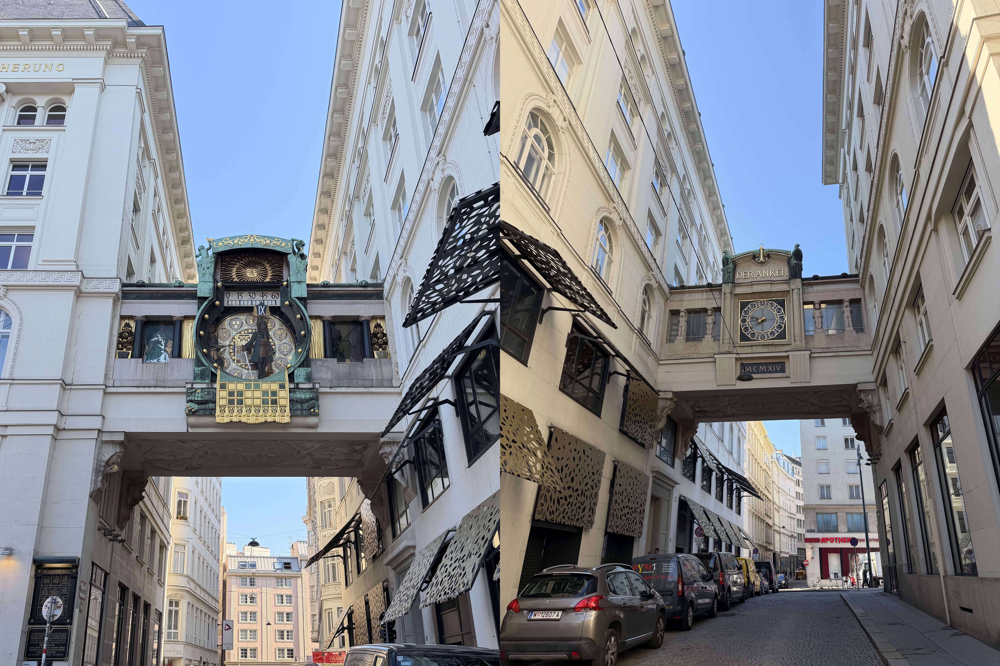
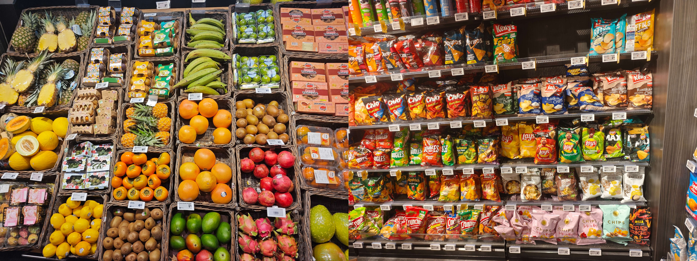
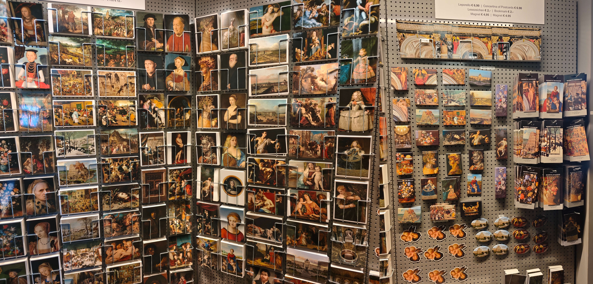
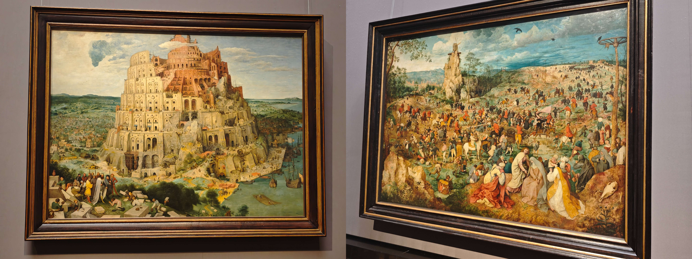
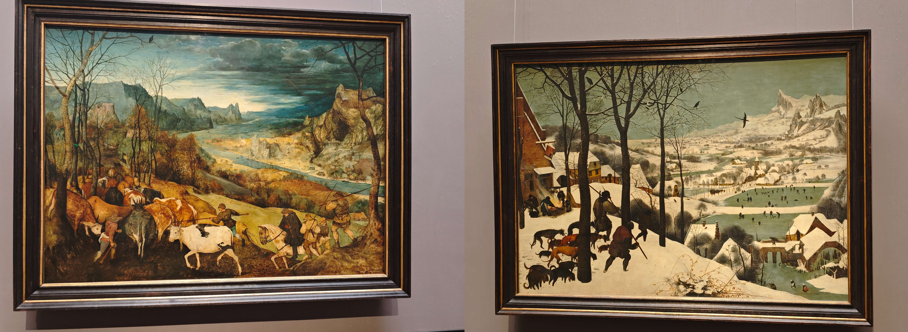
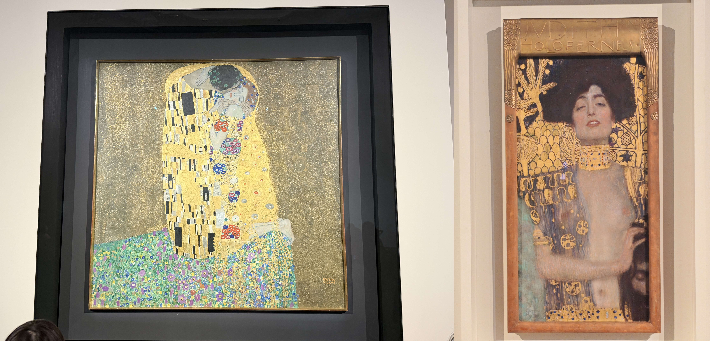
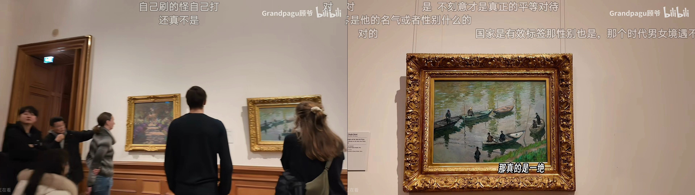
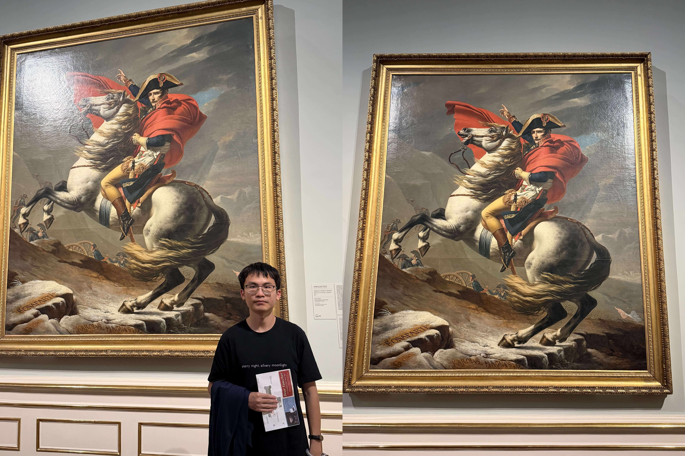

## 抵达

我们乘坐的是 MU2224 + MU5063 的东航组合从杭州飞抵维也纳。中转西安落地时是大晚上，励颖心心念念想要吃𰻞𰻞面，可惜大部分店铺已经关门，步行至国际中转时才有零星店面营业。我们合吃了一碗臊子面，没有用完好客西安的中转福利。这次旅行前我们各自选购了一只价格不菲的脖枕，以克服近十小时的长距离飞行。**没想到实际飞行时，脖枕主要辅助的是我的腰**。主要怪东航没有发枕头，虽说脖子上挂着很舒服，但如果不把脖枕靠在腰上就根本睡不着。夜行航班采用经典的头尾发餐食、中段熄灯的模式，我睡了前中段，后段睡不着了就起来看了部《侏罗纪世界2》。抵达维也纳后排了半小时的队丝滑出关，海关工作人员没有任何盘问。唯一可惜的是这次没有在护照上敲章，事后查阅小红书，说申根区已经在 2026 年 4 月 10 日起用电子签全面用取代盖章，有点可惜。

维也纳的第一关是机场交通，小红书上五花八门且带有时效性的交通讯息让人眼花缭乱。

- 最科学的方案看起来是购买（市区）交通通票+与之配套的 $2.2$€ 特惠机场线，但维也纳从 2026.1.1 起取消了 48h 和 72h 的交通通票，24h 通票对我们“第一天 City Walk 第二天公交连刷博物馆”的规划很不友好。
- CAT 机场快线因 *S-Bahn* 主线大修（8 月 *Praterstern* 站电缆火灾后提前）于 2026 年 8 月 24 日起改由豪华大巴运营，预计持续约 14 个月至 2027 年 10 月底。大巴一趟 $14.9$€，旅客的钱真好挣。
- 最终我选择了 ÖBB REX7 的一次性出行方案，$5.5$€ 一趟去市区，附送 2h 内的市区交通。

我们惊喜地赶上了 $7:34$ 发车的 ICC544。这是一种城际火车，能够 15min 直达维也纳中央火车站 *Wien  Hauptbahnhof*（而传统 REX7 火车要坐三站），之后继续向萨尔茨堡行进。我们的酒店选在了 *APPARTEMENT-HOTEL AN DER RIEMERGASSE*，在圣斯蒂芬主教座堂边上，需换乘一次 U1 至 *Stephansplatz*。风格和先前的罗马 *Cassiodoro 19* 类似，嵌入在一个古色古香的建筑里，楼层之间有个漂亮的雕花镂空老式电梯摆渡。

## 上午 City Walk

励颖的巴黎可颂之魂早于罗马 gelato 之魂发动，刚出门就买了个 $1.95$€ 的杏仁可颂。我们买瓶装可乐的时候还闹了个笑话，自助收银机上一扫可乐就会自动加上一行名为 *Einwegpfand* 的 $0.25$€ 费用，我们手忙脚乱操作了半天也删不掉，求助 kimi 后才得知这是奥地利 2025 年起强制实施的饮料瓶押金制度瓶，在任意超市的退瓶机里回收后才能返还这笔 $0.25$€。等我攒齐两个空瓶后去体验了一番，机器里会有气流来吸入空瓶。

我们卡着 $10:00$ 的时间抵达安可钟 *Ankeruhr*，和一小部分旅客傻乎乎地在钟下站了几分钟，什么都没发生。比较反直觉的是，这口钟最初是安可保险公司 *Der Anker* 在 1911-1914 年出资建造的，因此而得名。安可钟隔壁有一家非常大的超市，我们得以一窥奥地利的蔬果和零食风格。面对满满一个薯片柜子，kimi 推荐 $2.19$€ 的奥地利国民品牌 Kelly's 扁豆脆片，并指出甜椒味 *Paprika* 是奥地利国民风味，我们尝了尝感觉味道平平。

圣斯蒂芬主教座堂 *Stephansdom* 是典型的哥特式建筑，136m 高的南塔像垂直上冲的黑色竖琴。其宏伟地坐落在维也纳老城，周围街巷如众星拱月般环绕着它，神似佛罗伦萨圣母百花大教堂的周边。教堂外观的主要看点是彩瓦屋顶，约 23 万块彩釉陶瓦当作像素，拼成了马赛克画风的双头鹰，这是哈布斯堡神圣罗马帝国的标志。

打开励颖的宝典，这顿午饭选在 *Figlmüller*，这是一家以炸猪排闻名的百年老店，原店开在 *Wollzeile*，后来在隔壁的 *Bäckerstraße* 开了一家新店 。由于没有预约，我们得卡着十一点开业时间去老店，很幸运地排到一张一个小时后有预约的桌子。听说这里的招牌炸猪排 *Wiener Schnitzel* 分量很大，点完后为了防止尴尬我们补了杯葡萄汁，共计 $26.4$€。事实证明我们的决策是对的，两人合力都吃不完。我对猪肉不感兴趣，尝起来是比较嫩的原味猪排；励颖的评价很高，她指出内部这么大块的完整薄肉肯定是用手法砸过的，而将外皮炸得如此酥脆轻薄也很可贵。

吃完午饭临近 $12:00$，正好再次步行去安可钟，此时广场上已是人山人海。这口钟在慢了 $4$ 分钟后确如攻略所说开始表演，伴随着音乐依次展示了维也纳历史上十二位著名人物。由于没有做足功课，我们听了个响就撤了。

走在维也纳老城，石板路上经常会叮叮当当地驶来一辆马车。两匹马齐头并进，马嘴和马屁股上都套有袋子。马车往往会堵住后方的公交车或私家车，司机们只能耐心地跟在马车后面，现代都市中的这番景象给人一种魔幻感。这很容易让人联想到巴黎的马，但后者不是用来拉旅客的，而是用于共和国卫队的仪仗骑兵或街头巡逻的骑警。

我们沿着格拉本 *Graben* 大街散步，沿途寻访了一些著名的景点或店铺。

- 逛了 *H.D. Rauch GesmbH - Auktionshaus*，邮票和古币价格实惠，我俩总共选购了 $7$€ 的明信片和老邮封。
- 大街正中央是维也纳黑死病纪念柱 *Pestsäule*。黑死病（鼠疫）是人类历史上最惨烈的传染病，致使欧洲约三分之一到一半人口死亡。当 1679 年鼠疫传入维也纳后，皇帝利奥波德一世 *Leopold I* 仓皇逃出城，许下誓言说如果瘟疫退去，就立一根柱子感谢上帝；1693 年，今天这根巴洛克式的纪念柱就在格拉本大街落成。
- 在 *Demel* 排了十分钟的队尝了 $9.5$€ 的大份国王煎饼 *Kaiserschmarrn*，我非常喜欢李子酱的味道。
- 导航去励颖最爱的罗马冰激凌连锁店 *Gelateria La Romana dal 1947*，买了 $4.6$€ 的双球。每次 Gelato 的口味都不知如何选，我们翻来覆去点的都是酸奶、莓果或开心果。励颖锐评味道不错但不如罗马正宗。
- 导航去网红纪念品店 *THE WORLD TO GO VIENNA*，可惜热门的 $8$€ 冰箱贴《吻》已经断货了。

霍夫堡 *Hofburg* 是哈布斯堡家族的皇宫（冬宫），整座建筑里最迷人的就是书厅 *Prunksaal* / *State Hall*，前身是皇家宫廷图书馆，现在是奥地利国家图书馆。门票每个人 $12$€，我抱着试试看的心理追加了 $3$€ 的 Audio Guide，结果就是扫个码选中文播放，总共播个七八分钟就结束了，而且文字质量远不如我简单问一嘴 Kimi 来的高，**可谓是整趟欧洲行里最不值的开销**。博物馆里使用大模型解说的主要痛点是网络不稳定和逐个拍照很麻烦，我就选取了几个典型的机位给予其上下文和灵感。为了增加仪式感，我让 kimi K3 把生成的解说词转化成语音，他磕磕绊绊搞了一通后成功了（tool 还得打磨下，这种经典场景还得用 python 绕一圈远路生成），效果怪好的。

这座书厅的历史可追溯到 14 世纪的皇家藏书，当时约有藏书九千册；现在的建筑由美泉宫设计者、巴洛克建筑师菲舍尔费舍·冯·埃尔拉赫主持设计，于 1726 年落成，经费来源之一是卡尔六世对图书印刷业征收的专项税。大厅长约 80 米、穹顶高近 30 米，穹顶壁画描绘卡尔六世被神化的场景，厅内陈列约 20 万册 1501 至 1850 年间出版的古籍，全部只能隔着书柜观看，其中包括名将欧根亲王的一万五千册三色摩洛哥皮革装藏书。整个图书馆现有馆藏约一千两百万件，知名藏品包括六世纪紫色羊皮纸手抄本《维也纳创世纪》、1368年的《黄金福音书》、莫扎特和贝多芬的乐谱手稿、约十三万件古埃及莎草纸文献，以及 1602 年利玛窦绘制的《坤舆万国全图》。

逛完了城区的大片景点后，我们继续向西行进，自南向北打卡了三个建筑。

- 奥地利议会大厦 *Parlament Österreich* 建于 1874-1883 年，采用希腊复兴风格，柱子很瞩目。门前的雅典娜女神喷泉在 1902 年才完工，高达 5 米的智慧女神立于立柱顶端，右手托着胜利女神尼刻，基座四周的卧像分别代表帝国境内的四条大河（多瑙河、因河、易北河和伏尔塔瓦河），象征着当年奥匈帝国横跨中欧的辽阔疆域。这里是奥地利国民议会和联邦议会的所在地，立面两侧的青铜驭马雕像象征对权力的驯服。
- 维也纳市政厅 *Wiener Rathaus* 建于 1872 至 1883 年，采用新哥特式风格，造型参考了布鲁塞尔等佛兰德地区的哥特市政厅。据说皇帝下令市内世俗建筑的高度不得超过圣斯蒂芬大教堂的 136 米南塔，市政厅主塔因此只建了 98 米，顶端立着一尊 3.4 米高、手举军旗的铁甲骑士雕像。
- 沃蒂夫教堂 *Votivkirche* 的来历与一次刺杀有关：1853 年皇帝弗朗茨·约瑟夫一世在城墙上散步时遇刺，衣领替他挡下了致命一刀，侥幸生还。他的弟弟马克西米利安随即发起全民捐款修建这座感恩还愿教堂（*Votiv* 就是还愿的意思），1856 年动工、1879 年落成。教堂为典型的新哥特式双塔结构，造型模仿法国哥特主教堂，但呈现更完美的对称。通体洁白的镂空石雕辨识度极高，双尖塔因上述同样的原因建了 99 米。

沃蒂夫教堂双塔之间有一个无穷大符号，这其实是一件当代灯光艺术装置，名为"光之无限"（*Unendlichkeit des Lichtes / Infinity of Light*），出自奥地利女艺术家比莉·坦纳 *Billi Thanner* 之手，2025 年 12 月 16 日才正式点亮。其原计划展至 2026 年 8 月 1 日，由于反响很好，展出已被延长至 2027 年 5 月底。据说它在每天日落后亮起，灯光会在暖白与彩色之间渐变循环，小红书上有相关的展示但没有具体的时间攻略。

沃蒂夫教堂对面有个公园，我们像很多游客一样坐在草坪上，自 $16:30$ 开始一直等到落日后的 $18:50$，终于等到了装置发光。暮色里金、绿、蓝三色光环在两座哥特塔尖之间流转，古老教堂和当代艺术同框，相当出片。可惜我俩被寒风吹得太冷了，欣赏了十几分钟就打道回府了，也放弃了市政厅边上的地窖餐馆 *Wiener Rathauskeller*。

## 卡尔教堂

在小红书里刷到过欧洲各国对中国人的歧视，**不过这次欧洲之旅里不仅没有遇到，还多次遇到了当地人的善意或是帮助**。印象最深刻的一次就是第二天退房后我们拖着行李箱去火车站寄存的途中，出地铁后我们下意识地往某一侧宽阔的楼梯上去，结果有个老外从行李箱判断出我们的意图，连比带划地告诉我们这里是 wrong direction。

火车站有专属的寄存区，XL 的寄存柜能轻松塞入两个 20 寸的行李箱，24h 收费 $6.5$€。从维也纳火车站出来坐电车 D 线可前往卡尔教堂 *Karlskirche*，这是我们第一次在欧洲乘坐有轨电车，励颖锐评和香港的叮叮车体验类似。

卡尔教堂的来历同样与瘟疫和还愿有关：1713 年维也纳爆发黑死病，皇帝卡尔六世 *Karl VI* 许愿若瘟疫退去，就为瘟疫守护圣人圣嘉禄·鲍荣茂建一座教堂。"嘉禄"是天主教会的传统译名，对应拉丁语 Carolus；而在德语里这个名字写作 *Karl*，恰好与皇帝同名。所以教堂名 *Karlskirche* 是带有小巧思的一语双关：既是献给圣嘉禄的还愿堂，也带着卡尔六世借同名圣人自我纪念的色彩。瘟疫平息后，教堂于 1716 年动工、1737 年完工，出自图书馆和美泉宫的设计者菲舍尔·冯·埃尔拉赫父子之手。教堂的外观是少见的混搭风格：古希腊神庙式门廊，两侧立着两根 47 米高的仿罗马图拉真柱的螺旋浮雕柱，柱身浮雕刻的是圣嘉禄的生平，背后则是 72 米高的巴洛克穹顶。

进入卡尔教堂的门票是 $9.5$€，线下只支持现金购买。教堂内部是典型的巴洛克装饰：主祭坛上方的采光亭和环形高窗把自然光直接引入，营造出巨大的鎏金放射状太阳光芒；中央嵌着代表上帝的三角形，四周云端的群雕表现圣嘉禄代世人向上帝求情、平息瘟疫的场景——正好呼应建堂的初衷。椭圆形穹顶的壁画描绘圣嘉禄升入天堂，据说采用了透视变形技法（只有在特定角度才能看出正确比例），但我们没有品出来。教堂里本有一部全景升降梯可以升到穹顶底部约 32 米的平台，据说可近距离看壁画细节，可惜这段时间电梯周边正在施工。进门回头，后廊上方有一台巨大的巴洛克管风琴，据说琴箱中部用的是 1739 年的原件，19 世纪和 20 世纪陆续有一些修复，至今仍会在音乐会中使用。沿着步梯来到二楼，可以近距离欣赏管风琴。楼里展出了一些衣物和饰品，俨然成为了一个小博物馆。再往上步行就走到了教堂外部的平台，可俯瞰卡尔广场的水池和维也纳的天际线。

## 艺术史博物馆

维也纳最出名的莫过于艺术史博物馆 *Kunsthistorisches Museum*，我很早就在携程订好了 $10:45$ 的门票，当天迟到了一个多小时，经过门口的工作人员一番提醒与交涉后还是混进去了。寄存柜很有意思，内部需要放入一枚 $1$€ 或 $2$€ 大小的硬币状圆形片以启用门锁。偌大的几排寄存柜都没有空位，我们只能耐心地等前来取包的游客。

维也纳艺术史博物馆于 1891 年开馆，是皇粹是取自帝弗朗茨·约瑟夫一世为安置哈布斯堡家族数百年收藏而建的皇家博物馆。馆内最出片的地方不是展厅，而是中轴线上的穹顶大厅：八边形穹顶高约 60 米，墙壁和立柱满铺各色大理石，地面上拼出了各类黑白的几何图案。大厅正中嵌着一圈红色圆形沙发，围绕中央开口而坐，头顶就是穹顶。现在这里是一家咖啡馆，也正是我们午饭要来打卡的目的地。由于到的时候正值饭点，在门口排了十五分钟的队。我们点了一份特色香辣香肠 *spicy KHM sausages*，一份苹果卷 *Apfelstrudel* 和一杯梅兰锡咖啡 *Melange*，共计 $29.4$€。只有苹果卷的口味给我们留下了深刻的印象，后续的欧洲旅行中我们发现这是很经典的美食。

糟糕的是，顾爷没有讲解过艺术史博物馆，B 站上也没找到其他靠谱的解说资料，我们只能像没头苍蝇一样乱窜，偶尔看到游客扎堆的名画就拿 Kimi 解说一下。不过逛了这么多博物馆，我们还是学会了一点小巧思的：开场先进纪念品店调研明信片和冰箱贴，以此获取对“待捕捉名画”的第一印象——这样我们不会错过大部分名作，比如勃鲁盖尔的大批作品。问题当然是存在的，例如事后发现维米尔的**《绘画艺术》**这种镇馆级名画被我们遗漏。

- **《巴别塔》**是勃鲁盖尔最负盛名的作品，他总共画过两幅，较小的那幅在鹿特丹。背景出自《创世记》：人类造塔通天，上帝变乱语言使工程荒废。勃鲁盖尔把塔画成罗马斗兽场的样式，却刻意让它倾斜开裂，表达出一座注定烂尾的楼。前景左下角，一队衣着华丽的人物来到工地，通常被解读为宁录王巡视工程。
- **《基督背十字架赴各各他》** 是勃鲁盖尔画幅最大的作品。题材源自圣经，基督背负十字架正在前往各各他（髑髅地）受刑的路上；画面却是 16 世纪佛兰德斯的赶集日，五百多个人物中主角基督摔倒在画面正中央，小到几乎找不到。把圣经故事"藏"进世俗场景、让观者自己去寻找，是他标志性的手法。
- **《牧归》**是勃鲁盖尔"月令组画"中的秋季。这组画原为尼德兰富商的宅邸订制，六幅对应一年十二个月，如今仅存五幅，维也纳独占三幅，另外两幅分藏纽约大都会和布拉格。主题是深秋时节，牧人赶着牛群从山上的牧场返回村庄。勃鲁盖尔没有去画宗教或神话，而是把镜头对准了这场季节转换的劳作本身。
- **《雪中猎人》** 是勃鲁盖尔"月令组画"中的冬季，也是西方艺术史上最著名的冬景画，没有之一。猎人和猎犬空手而归、垂头丧气，画面几乎全是冷色；唯有远处冰面上滑冰嬉戏的村民透出暖意（冬季对猎人是无情的，对村民却是节日）。它对后世冬季风景画影响极深，塔可夫斯基等导演都在电影里致敬过这个构图。
- **《草地上的圣母》**是拉斐尔佛罗伦萨时期的代表作。年轻的他受达芬奇影响，把圣母、圣子与小约翰安排成稳定的金字塔形构图，配上宁静田园，成为文艺复兴"和谐之美"的范本。他这一时期画过一组三张构图相近的圣母像：乌菲兹的《金丝雀圣母》、卢浮宫的《美丽的园丁》加上这幅，并称佛罗伦萨三大圣母。
- **《圣玛格丽特与龙》** 。传说圣女玛格丽特被恶龙吞下后划破龙腹而出。卢浮宫另有一幅同题材的《圣玛格丽特》，构图相似但服饰姿态不同，哪幅出自拉斐尔亲笔、哪幅是学徒代笔，至今争论不休。
- **《水》《冬》《夏》《火》** 是阿尔钦博托创作的一组肖像，用海鲜拼成"水"、枯树根拼成"冬"、瓜果麦穗拼成"夏"、火器烛台拼成"火"。原作包括《四季》（春夏秋冬）和《四元素》（土气火水），这里独占四幅。注意《火》胸前挂着金羊毛骑士团徽章和双头鹰（哈布斯堡皇权的符号），即暗示"火"就是皇帝本人。
- **《大卫手提歌利亚的头》**：卡拉瓦乔画这幅作品时，刚在斗殴中杀了人，正被通缉逃亡。歌利亚那颗痛苦扭曲的头是他自己的脸，年轻的大卫也是他——研究者普遍从中读出一种"我杀死了自己"式的忏悔。
- **《玫瑰经圣母》** 是卡拉瓦乔画幅最大的作品，也是他罕见的正统祭坛画。此画生前滞销，他死后被鲁本斯慧眼识珠、推荐买家购藏，几经辗转进入皇家收藏——维也纳这间展厅是卡拉瓦乔与鲁本斯的双重缘分。
- **《荆棘冠冕》**——士兵以荆棘为基督加冕，暴力与屈辱被压缩进一个近距离的画面，强烈的明暗对比（chiaroscuro）正是卡拉瓦乔留给整个巴洛克时代的遗产。
- **切利尼盐罐** 是文艺复兴金匠切利尼为法国国王弗朗索瓦一世打造的黄金珐琅盐罐，也是他唯一存世的黄金作品。斜倚的男女是海神与大地女神，寓意盐出自海与地。它在法奥两国皇室间辗转后入藏此馆，2003 年被一名惯偷凌晨破窗盗走勒索赎金，三年后竟完好追回——这次失窃反而让它名声大噪，如今在珍宝馆独享展柜。

## 美景宫

美景宫（*Belvedere*，贝尔维德） 是欧根亲王的住所。下美景宫（红色）于 1712-1716 年先建成，是亲王日常居住的地方；上美景宫（绿色）于 1723 年完工，专用于宴饮和庆典。上美景宫是标准的巴洛克对称设计，“上”与“下” 的命名则纯粹源于地势的高低。欧根亲王死后，宫殿被皇室收购，1781 年这里被辟为皇家画廊向公众开放，是世界上最早的公共博物馆之一。1955 年，标志奥地利恢复独立的《奥地利国家条约》就是在上美景宫的大理石厅签署的——签完条约的外交官们直接走上露台向民众挥手，那张照片是奥地利战后最经典的历史画面。

门票不抢手，现场再订都来得及。有 [顾爷视频](https://www.bilibili.com/video/BV19n9SB8ENk) 的提携，我们在上美景宫寻觅名画的进程可谓是势如破竹。

这里也需要寄存，方式完全相同。单刀直入地上楼，首先会进入一个偌大的厅堂。尽管有顾爷的提前点拨，我们仍惊叹于天花板和四周门厅上高超的画技：**周围一圈看起来凹凸不平的“建筑软装”，实际上都是画上去的**。

维也纳画家古斯塔夫·克里姆特 *Gustav Klimt* 出身金匠家庭，早期是装饰画家，1897 年因不满官方学院派的保守，带领一批年轻艺术家脱离艺术家协会，自立"维也纳分离派" *Secession*。他最著名的时期是"金色时期"：受拜占庭马赛克和父亲金匠手艺的影响，在画中大量使用金箔。美景宫是克里姆特画作的主要收藏地。

- **《吻》**是克里姆特"金色时期"的巅峰，是美景宫的镇馆之宝，也是奥地利的第一文化名片。一对恋人跪在悬崖边开满野花的草地上相拥而吻，两人全身被金箔包裹的图案覆盖：男袍是黑白矩形，女裙是彩色圆形花纹——一刚一柔的图案语言是看点所在。女人受吻后给人一种不拒绝但不接受的感觉。克里姆特本人对画作含义守口如瓶，世界各地的专家就掏空心思解读，诸如女人跪在悬崖边象征着危险，男人身上的方块象征着进攻。
- **《朱迪斯一号》**同样是克里姆特名作。这幅画长期被误认为画的是莎乐美，直到发现画框铭文上铸着 *JVDITH / HOLOFERNES* 字样才确证题材出自《旧约·犹滴传》：犹太寡妇朱迪斯色诱敌军将领荷罗孚尼并砍下其头颅，拯救全城。克里姆特把她画成半裸、迷醉、致命的蛇蝎美人，右手隐约攥着荷罗孚尼的头颅。
- **《弗里察·里德勒肖像》**、**《索尼娅·克尼普斯肖像》**都是克里姆特的代表肖像作品，画面里的女人总是很吸引人注视。他喜欢将装饰性的图案融入到写实作品中，形成一种独特的混搭风。
- 以金色肖像闻名的克里姆特，后半生最稳定的产出其实是风景画。从 1900 年起，他每年夏天都陪伴侣去阿特湖避暑，白天泛舟画画。这批画特别有辨识度：全部是正方形画幅，画面里几乎从出现人物，很多作品没有地平线，花草树木像马赛克一样铺满整个画面。据说他常站在对岸用望远镜取景，再回画室完成，所以画面有一种奇特的"被压平"的平面感。顾爷锐评：**画面仿佛是在二维和三维里切换，很适合放在家装环境里**。

埃贡·席勒 *Egon Schiele* 是克里姆特一手提携的弟子。他 16 岁考入维也纳美术学院，17 岁结识了克里姆特，19 岁退学拜其为师。师徒的艺术气质截然相反：克里姆特把爱欲包进金色装饰里，席勒则把人体画得扭曲、嶙峋、神经质，骨骼和青筋毕露，大批自画像和裸体画在当时被视为伤风败俗，甚至因传播淫秽图画被判入狱过。

- **《亚当与夏娃》**是克里姆特生命最后一年的作品，也是一幅**未完成之作**。1918 年 2 月他中风去世时，这幅画还立在画架上。画面里夏娃站在前景，裙裾缀满花朵，表情却是克里姆特晚期特有的恍惚与不安；身后亚当的形象只起了个模糊的轮廓，色彩未完成。这幅画的命运也和时代绑定，当年克里姆特、席勒相继去世，奥匈帝国也在同年解体——维也纳的黄金时代随着这幅画永远停在了"未完成"的状态。
- **《拥抱》**是席勒晚期著名作品，画的是他与妻子伊迪丝。一对男女在凌乱的白床单上紧紧相拥，线条扭曲、笔触暴躁、肢体纠结到几乎不分彼此。席勒的画大多是这种风格，顾爷评价画里只有荷尔蒙。

席勒的两幅杰作都与爱情和疾病有关。1915 年席勒为了迎娶门当户对的伊迪丝，结束了与相恋四年的沃莉。**《死神与少女》**借用中世纪"死亡之舞"的传统，画中黑衣的"死神"其实就是席勒自己，被他放手的少女就是沃莉。枯槁的死神从背后抱住蜷缩的少女，两人裹在凌乱的床单里，悬在一片荒芜的岩土之上。悲伤的是，沃莉离开席勒后做了战地护士，1917 年死于猩红热。**《家》**的背景更为凄凉。28 岁的席勒正迎来事业转机，怀孕六个月的妻子却感染西班牙流感去世，三天后席勒本人也死于流感。画中的孩子其实并未出生，是席勒想象出来的。

原本有一面墙上展览的是两幅莫奈的风景画，我们实际寻觅时，右边这张被替换了。因为今年正值莫奈逝世 100 周年，巴黎橘园美术馆从 2026 年 9 月 30 日起举办百年纪念大展 *Monet. Painting Time*，这幅画应该被借走了。

有两幅并排的作品画的都是 1908 年的欧洲，奥地利画家歌颂土地的劳作，挪威画家歌颂大海与身体。

- **《收获》** 由维也纳分离派圈子里的女画家布龙齐娅·科勒-皮内尔 *Broncia Koller-Pinell* 作画。画中金色的麦田上农人俯身收割，麦垛排成装饰性的阵列，笔触厚重粗粝，色彩明亮而沉稳，明显受到梵高和点彩派的影响。签名 *B. Koller* 在画面右下角，还带着 1908 的年款。当年正是她的黄金年份，她与克里姆特、霍夫曼等人一同参加了维也纳艺术史上著名的维也纳艺术展 *Kunstschau Wien 1908，是当时极少数以职业画家身份活跃的女性。可惜她后来长期被艺术史遗忘，直到近年才被重新发掘。顾爷锐评介绍里不应该着重突出其性别。

- **《海滨浴者》**的作者是爱德华·蒙克，就是画《呐喊》的那位挪威画家，风格类似梵高。这幅画画于蒙克在德国瓦尔内明德的海滨疗养期间，所以气质与《呐喊》截然相反。此后他仍因酗酒与精神危机入院治疗。

**《拿破仑跨越阿尔卑斯山圣伯纳隘口》** 是新古典主义大师雅克-路易·大卫的名画，描绘了 1800 年 5 月拿破仑率领大军翻越阿尔卑斯山大圣伯纳德隘口奇袭意大利奥军的场景。但画面与史实相去甚远，拿破仑实际骑的是一头骡子走在大部队后面，而画中的他骑着前蹄腾空的白马、红斗篷猎猎、手指山顶——这是应拿破仑本人要求做的美化。大卫共绘制了五个几乎相同的版本，分别藏于马尔梅松、柏林夏洛滕堡宫、凡尔赛宫（两幅）和这里。

美景宫展厅里的"鬼脸雕塑"极具特色，作者是梅塞施密特 *Franz Xaver Messerschmidt*，这一系列被称为性格头像 *Charakterköpfe*。梅塞施密特本是维也纳最成功的宫廷雕塑家：出身德国，为玛丽亚·特蕾莎女皇和皇室成员塑造过标准的新古典主义肖像，还在美术学院当教授，前途一片光明。但他在 1760 年代末开始出现严重的精神问题，被迫离开教职回到故乡，在近乎隐居的状态下创作了六十多座"性格头像"，即秃顶的中年男子做着各种极端表情。这些头像有几个谜团至今没有定论：它们不是任何真实人物的肖像，模特可能就是梅塞施密特自己。据说他一边对着镜子掐自己的肋骨、扭曲面部，一边雕刻，像是在做一场持续十几年的表情实验。

当天在不同景点摆渡时，如果需要乘坐地铁或者有轨电车，每当单次票的 80 分钟时效过期后我总是很老实地再去买。小红书里总是能刷到逃票被罚的经历（一般是没显式打卡起始时间），而我们在一整天的市内公共交通里都没遇到查票的人。 $5.5$€ 的机场线我也老老实实买票了，这次真的遇到了检票员，所以不能抱有侥幸心理哈哈。

当晚我们乘坐 $22:20-23:40$ 的瑞安航空离开奥地利维也纳，前往克罗地亚杜布罗夫尼克。这家欧洲廉航属实令人惊艳，单趟机票的价格只需 $155$¥（$22$€）——只要别忘记在起飞前 24h-2h 内线上值机就行，否则线下值机会有每人 $55$€ 的罚款。carry-on 的行李默认只有一个小包，我们就每人加购了 $27.5$€ 的 20 寸行李箱。
